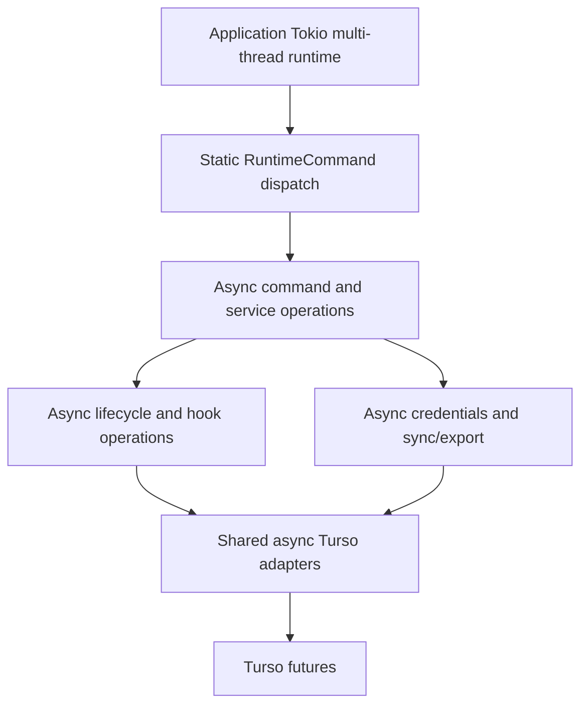

# Architecture

## Mutation-scope harness adapters

The mutation-scope runtime now has four concrete lifecycle adapters: Claude Code, Codex, OpenCode, and Pi. Codex is implemented in `cli/src/services/hooks/codex_mutation_scope/` and reaches the generic ingress through its in-process seam; its hidden command is registered by the shared Codex setup/merge/doctor path. The Codex adapter's tracked-tool coverage and MCP boundary are documented in [`context/cli/codex-mutation-scope-integration.md`](cli/codex-mutation-scope-integration.md).
OpenCode's tool lifecycle has been frozen against `@opencode-ai/plugin@1.15.4` and OpenCode CLI 1.15.4, and its adapter in `cli/src/services/hooks/opencode_mutation_scope/` (hidden `sce hooks opencode-mutation-scope`) now drives the same in-process seam with a full `Start`/`Close`/`Abandon` lifecycle, checkout-local durable state under `<git-dir>/sce/` (attempt phases `PendingStart` → `Active` → `PendingAbandon`), and a generation-tracked recovery barrier. Exact `ToolError` evidence persists the doomed attempt as `PendingAbandon` before any cleanup seam call and the attempt is removed only after the generic `abandon` succeeds, so a transient cleanup failure is retried rather than losing the scope. A generated `sce-mutation-scope.ts` transport plugin (`config/lib/mutation-scope-plugin/`, registered last in the OpenCode `plugin` array) is installed as the final OpenCode plugin by `sce setup` — the config merge appends it after arbitrary user plugins and `sce doctor` flags any non-last position — so real OpenCode sessions now reach the adapter.
Pi's adapter, in `cli/src/services/hooks/pi_mutation_scope/` (hidden `sce hooks pi-mutation-scope`), tracks `bash`/`edit`/`write` with a `PendingStart`/`Executed`/`Closed`/`PendingAbandon` lifecycle keyed on Pi's `tool_result` event; the canonical generated Pi extension now drives it from ordinary Pi sessions with fail-closed delivery. That extension also invokes the related, harness-neutral `sce hooks external-mutation-guard` process (Unix-only) for human `!`/`!!` shell commands, keeping them outside AI scopes while the durable guard is active. See [`context/cli/opencode-mutation-scope-integration.md`](cli/opencode-mutation-scope-integration.md), [`context/cli/opencode-mutation-scope-adapter-lifecycle.md`](cli/opencode-mutation-scope-adapter-lifecycle.md), [`context/cli/pi-mutation-scope-integration.md`](cli/pi-mutation-scope-integration.md), and [`context/cli/mutation-trace-external-mutation-guard.md`](cli/mutation-trace-external-mutation-guard.md).

All four adapters attach optional `ScopeProvenance` at admission (OpenCode
stamps `oc_<sessionID>` and the observed model, else `NULL`). The verified
mutation protocol still decides scope ownership and `AiExclusive(scope)`;
provenance is observational metadata resolved later into mutation-derived
Agent Trace evidence. Real Claude/Codex/OpenCode regressions cover this
boundary through commit and persisted `agent_traces.trace_json`, including
OpenCode's concurrent reject-and-confirm and cross-harness overlap cases.

## Config generation boundary (current approved design)

Canonical Pkl content and target renderers produce temporary payloads for CLI
embedding and packaging. See [config generation architecture](sce/config-generation.md)
for source ownership, target inventories, and generation contracts. Claude's
`sce-info` runtime package is separate from the shared workflow inventories;
its installation follows the [per-asset setup policy](sce/setup-no-backup-policy-seam.md).

## Placeholder SCE CLI boundary

The repository includes a new placeholder Rust binary crate at `cli/`.

## CLI install/distribution boundary

- The current implemented binary install/distribution surface for the `sce` CLI includes repo-flake Nix, Cargo, and npm; `Homebrew` is deferred from the active implementation stage.
- Flatpak is also an official supported distribution channel for this implementation stage under application ID `dev.crocoder.sce`, with a source-built Flatpak package rather than a wrapper around Nix-built, native GitHub Release binary, npm native, or other prebuilt `sce` artifacts.
- Nix-managed build/release entrypoints are the source of truth for existing binary build outputs and release automation, and Nix may orchestrate Flatpak tooling, local-source overrides, and validation without becoming the Flatpak package's binary source.
- The implemented Flatpak packaging/tooling surface lives under `packaging/flatpak/` with Nix-owned generation: `dev.crocoder.sce.yml` is the Flathub-style source-build manifest rendered from a Nix expression (`nix/flatpak/manifest.nix`) via the standard nixpkgs YAML formatter (`pkgs.formats.yaml.generate`) and regenerated by `nix run .#regenerate-flatpak-manifest`; `cargo-sources.json` is produced from `cli/Cargo.lock` by a Nix derivation (`nix/flatpak/cargo-sources.nix` wrapping `flatpak-builder-tools`/`flatpak-cargo-generator.py`) and regenerated by `nix run .#regenerate-cargo-sources`; both are guarded by parity checks (`flatpak-manifest-parity`, `cargo-sources-parity`). Static manifest validation is Bash-owned at `nix/flatpak/static-validate.sh` and wrapped by Nix as `flatpak-static-check`; release-version parity validation is Bash-owned at `nix/flatpak/version-parity.sh` and wrapped by Nix as `flatpak-version-parity-check`. `dev.crocoder.sce.metainfo.xml` is the AppStream metadata, and `git-host-bridge` delegates runtime Git access to `flatpak-spawn --host git`. Because the Flatpak sandbox has no Pkl, `sce-flatpak.sh` prepares a checksummed fallback in the temporary manifest support directory before `flatpak-builder`; the manifest copies it into `cli/package-fallback` as a `type: dir` source and sets `SCE_CLI_PACKAGE_FALLBACK=1` in the module build environment so the sandboxed repository checkout builds from that fallback rather than requiring a generated-input handoff.
- GitHub Release Flatpak source-manifest assets remain source-oriented rather than binary artifacts: `nix run .#release-flatpak-package -- --version <semver> --out-dir <path>` packages the manifest/support files plus an ephemeral checksummed fallback payload, with the staged manifest pinned to the release commit. The fallback is copied into `cli/package-fallback` by Flatpak's source list so Cargo can build without Pkl inside the sandbox.
- Flatpak GitHub Release assets now also include source-built `.flatpak` bundle assets (`sce-v<version>-x86_64.flatpak` / `sce-v<version>-aarch64.flatpak` plus `.sha256` / `.json`) alongside source-manifest packaging metadata.
- Automatic Flathub submission, prebuilt (non-source-built) Flatpak binaries/bundles, OSTree repositories, release-version bumping, and Flatpak publication beyond the approved GitHub Release asset upload remain outside the current iteration.
- Repo-root `.version` is the canonical checked-in release version authority across GitHub Releases, Cargo publication, and npm publication.
- GitHub Releases are the canonical publication surface for release archives, checksums, release-manifest assets, npm package assets, and approved Flatpak source-manifest and bundle assets.
- Cargo/crates.io and npm registry publication belong to separate downstream publish stages that consume already-versioned checked-in package metadata rather than inventing release versions during workflow execution.
- Crates.io packaging is self-contained through ignored `cli/package-fallback/`: the preparation script delegates canonical Pkl generation and inventories to the shared producer, moves its validated payload and checksums into a temporary staged fallback, adds static hooks/schemas/migrations, and appends static checksums to the exact combined inventory. `cli/Cargo.toml` includes only that fallback and crate sources, and unpacked-crate `build.rs` validates then copies it into `OUT_DIR` without Pkl. Repository builds use `scripts/run-cli-cargo.sh`, which consumes the same producer before Cargo; `build.rs` requires the resulting `SCE_CLI_GENERATED_INPUT_DIR` handoff and copies it into `OUT_DIR` without invoking Pkl.
- npm is a downstream consumer of the shared release artifact contract rather than a separate build owner.
- `flake.nix` now exposes dedicated release-packaging apps for this rollout: `apps.release-artifacts` packages the current-platform `sce` archive/checksum/manifest-fragment set from the release output `packages.sce-release` (`nix build .#sce-release`), prepares/audits the staged `bin/sce` before archive creation (including macOS `libiconv` install-name rewriting plus ad-hoc re-signing when needed), and fails if `.version`, `cli/Cargo.toml`, `npm/package.json`, the built/prepared CLI version, or the native portability audit disagree; `apps.native-portability-audit` audits native binaries for forbidden `/nix/store/` runtime references using Linux ELF/string inspection or macOS `otool -L`; `apps.release-manifest` merges per-platform metadata fragments into release-level manifest/checksum outputs and signs the merged manifest with a non-repo private key provided via env/file input; `apps.release-npm-package` packs the checked-in npm launcher package into a release-ready `sce-v<version>-npm.tgz` tarball plus npm metadata JSON while refusing mismatched checked-in version metadata; and Linux-only `apps.release-flatpak-package` emits the Flatpak source-manifest tarball/checksum/JSON metadata while refusing `.version`/Cargo/npm/AppStream version drift and non-git checkouts that cannot resolve a release commit; Linux-only `apps.release-flatpak-bundle` builds a source-built `.flatpak` bundle from the checkout and emits per-architecture bundle/checksum/JSON metadata.
- CLI release automation: `.github/workflows/release-sce.yml` orchestrates `sce` GitHub release asset assembly, validates `.version`/Cargo/npm parity before tagging or releasing, calls three reusable per-platform workflow files (`release-sce-linux.yml`, `release-sce-linux-arm.yml`, `release-sce-macos-arm.yml`), assembles the signed native release manifest, builds npm and Flatpak source-manifest release packages, and uploads the CLI/npm/Flatpak asset set to the GitHub Release. Each native reusable workflow validates its generated archive before native artifact upload by extracting the target archive, smoke-running `bin/sce version --format json`, and running `nix run .#native-portability-audit` with the lane platform. Manual `workflow_dispatch` runs can set the GitHub Release-level `prerelease` flag through an explicit checkbox; tag-triggered releases keep the flag false and no tag-name prerelease inference is performed.
- Downstream registry publication is now implemented in dedicated workflows: `.github/workflows/publish-crates.yml` publishes the checked-in crate version from a published release or manual dispatch after `.version`/tag/Cargo parity checks and requires semver prerelease metadata when a publish run is marked prerelease; `.github/workflows/publish-npm.yml` publishes the checked-in npm package version from a published release or manual dispatch after `.version`/tag/npm parity checks plus verification of the canonical `sce-v<version>-npm.tgz` GitHub release asset, using the `next` npm dist-tag instead of `latest` for prerelease versions or prerelease-marked runs.
- The npm distribution implementation lives under `npm/`: `package.json` defines the `sce` package surface, `bin/sce.js` launches the package-local native binary, `lib/install.js` resolves the current package version against the release manifest, verifies `sce-v<version>-release-manifest.json.sig` with the bundled public key before trusting manifest contents, and then installs the checksum-verified native archive for supported macOS/Linux targets, while `test/platform.test.js` and `test/install.test.js` cover platform selection plus signed-manifest installer behavior.

- `cli/src/main.rs` is the executable entrypoint (`sce`) and delegates to `app::run`.
- `cli/src/cli_schema.rs` defines the clap-based CLI schema using derive macros for all top-level commands and subcommands, including the top-level `sync` command, and renders command-local help text for the `auth` command tree (`auth`, `auth login`, `auth logout`, `auth whoami`).
- `cli/src/app.rs` provides the clap-based argument dispatch loop with deterministic help/setup execution, bare-command help routing for `sce auth` and `sce config`, successful unknown-command fallback to top-level or closest-parent help, centralized stream routing (`stdout` success payloads, `stderr` redacted diagnostics), stable class-based exit-code mapping (`2` parse, `3` validation, `4` runtime, `5` dependency), and stable class-based stderr diagnostic codes (`SCE-ERR-PARSE`, `SCE-ERR-VALIDATION`, `SCE-ERR-RUNTIME`, `SCE-ERR-DEPENDENCY`) with default `Try:` remediation injection when missing.
- The app runtime now moves through explicit startup phases in `cli/src/app.rs`: dependency bootstrapping (`perform_dependency_check`), startup context construction (`build_startup_context`), runtime initialization (`initialize_runtime`), directly awaited command parse/execute inside the telemetry polling scope (`run_command_lifecycle`, `parse_command_phase` plus `services::app_support::execute_command_phase`), and final output rendering through `services::app_support::render_run_outcome`. `AppRuntime` owns the concrete production logger, no-op telemetry runtime, filesystem ops, git ops, static `CommandRegistry`, and startup-diagnostic state across those phases; `RunOutcome<L>` carries final render data with an optional generic logger implementing `services::observability::traits::Logger`, so render support can log classified errors without production-logger type coupling. If a telemetry implementation attempts to invoke the command action more than once, dispatch returns a runtime-classified error instead of panicking or reusing consumed arguments.
- `AppContext` is the CLI's borrowed dependency view in `cli/src/app.rs`: it is generic over logger, telemetry, filesystem, and git capability implementations and stores references plus an optional `repo_root: Option<PathBuf>` instead of owning `Arc<dyn ...>` trait objects. Because it borrows from `AppRuntime`, `AppContext` is command-scoped: borrowing across directly awaited execution is safe while the owner lives, but detached work cannot retain that borrowed view. No new `Send`, `Sync`, or `'static` command bounds are required. Startup creates a context view over `AppRuntime`'s concrete production dependencies with `repo_root` set to `None`; command paths can derive repo-root-scoped context views through the `ContextWithRepoRoot` accessor trait / `AppContext::with_repo_root(...)`, which reuses the same borrowed dependencies while attaching the resolved root. Narrow accessor traits expose associated concrete capability types for logger, telemetry, fs, and git (`&Self::...`) plus repo-root access, so call sites can express capability requirements without erasing the borrowed dependencies back to trait objects; lifecycle providers consume the repo-root accessor rather than the full context type.
- Command parse-time conversion and run-time handling are separated by an internal static `RuntimeCommand` seam. `cli/src/services/command_registry.rs` defines the `RuntimeCommand` enum with variants for help/help-text, version, completion, auth, config, setup, doctor, hooks, policy, sync, and plan, plus a deterministic `CommandRegistry` name catalog populated by `build_default_registry()`. `parse_command_phase` in `cli/src/app.rs` delegates clap-output conversion to `cli/src/services/parse/command_runtime.rs`, which owns clap error classification, help rendering bridges, longest-valid-parent traversal for unknown command paths, and parsed-request-to-enum conversion while returning concrete enum values. Service-owned `command.rs` modules define command payload structs and generic execution methods with narrow context requirements: context-free commands accept any context, hooks requires logger access, setup/doctor require repo-root scoping, and central dispatch requires the union of logger plus repo-root-scoping capabilities. `services::app_support::execute_command_phase` emits lifecycle logs around `RuntimeCommand::execute_with_stderr(...)`; the enum performs the only central dispatch match and delegates business behavior to the service-owned command structs, with sync receiving the app-owned stderr writer for format-gated progress.
- Startup observability bootstrapping in `cli/src/app.rs` still tolerates invalid default-discovered config files by continuing with degraded defaults plus `sce.config.invalid_config` warn-level logs, but the warning/logging work is now isolated behind the startup-context and runtime-initialization phases rather than one inline startup function.
- `cli/src/services/observability.rs` provides deterministic runtime observability controls and rendering for app lifecycle logs, including shared config-resolved threshold/format, explicit config-file/default `log_to_file`, and `log_dir` inputs with precedence `env > config file > defaults` for non-flag observability keys, stable event identifiers, severity filtering, the forced-emission warning path used for invalid discovered config startup diagnostics, error-specific stderr suppression when file logging is enabled while non-error records and file-write diagnostics remain on stderr, redaction-safe emission through the shared security helper, and log-directory writes with bounded retention. Config resolution also carries a positive config-file/default-only `log_file_retention_limit` (`10` by default) into startup observability config and `sce config show`; the concrete logger stores that resolved value and threads it through primary and v2 cleanup. When `log_dir` resolves from `SCE_LOG_DIR`, config, or the `<state_root>/sce/logs` default, each enabled or forced log operation selects `<log_dir>/sce-<dd_mm_yyyy>.log` or `<log_dir>/sce-<dd_mm_yyyy>-<sanitized_session_id>.log` using the machine-local date and optional logger session context, with deterministic percent-encoding for unsafe session filename bytes; after successfully writing a newly created selected file, retention keeps the configured number of newest direct regular `*.log` files by mtime plus path/name tie-break and fails open on cleanup errors. Its `observability::traits` submodule exposes the current `Logger` API with `Option<&str>` session context plus the generic async, deliberately non-object-safe `Telemetry` capability and `NoopLogger`; the concrete observability `Logger` and `NoopTelemetry` implement those capability traits; `NoopTelemetry` installs no tracing subscriber. `services::app_support::render_run_outcome` consumes the logger through that trait boundary when logging classified errors and stdout-write failures.
- `cli/src/services/managed_telemetry.rs` (+ `managed_telemetry/trace_export.rs`, `managed_telemetry/log_export.rs`) owns hardcoded managed OTLP defaults, credential-backed runtime telemetry selection from the encrypted auth DB, and bounded fail-open OTLP/HTTP protobuf export of `sce.command` spans and allowlisted `Logger` events to the pinned canonical collector (metrics endpoint reserved, not exported); see `context/sce/cli-observability-contract.md`.
- `cli/src/services/observability.rs` no longer owns duplicate log enums or parsing helpers; it consumes the canonical primitive seam from `cli/src/services/config/mod.rs` and stays focused on concrete `Logger` behavior plus the `NoopTelemetry`-backed telemetry capability boundary.
- `cli/src/cli_schema.rs` is now the canonical owner for top-level command metadata for the real clap-backed command set (`auth`, `config`, `setup`, `doctor`, `hooks`, `policy`, `version`, `completion`, `sync`, `plan`), including the slim top-level help purpose text and per-command visibility on `sce`, `sce help`, and `sce --help`; `cli/src/command_surface.rs` remains the custom top-level help renderer and known-command classifier, adding the synthetic `help` row plus the ASCII banner while consuming that shared metadata instead of maintaining a parallel command catalog.
- `cli/src/services/default_paths.rs` is the canonical production path catalog for the CLI: it resolves config/state/cache roots with platform-aware XDG or `dirs` fallbacks through an internal `roots` seam, exposes named default paths for current persisted artifacts and database/log files (global config, auth tokens, auth DB, local DB, default observability log directory, and the sole Agent Trace DB path helper `agent_trace_db_path_for_repository` under `repos/<repository-id>/agent-trace.db`; the former global-sentinel and per-checkout Agent Trace path helpers were removed by the `retire-legacy-agent-trace-db` plan), and owns canonical repo-relative, embedded-asset, install, hook, and context-path accessors so non-test production path definitions have one shared owner. Compile-time generated payload paths are owned by `build.rs` under `OUT_DIR`, not by the default-path catalog. Current production consumers such as config discovery, observability config resolution, doctor reporting, setup/install flows, database adapters, checkout identity, Agent Trace storage resolution, and local hook runtime path resolution consume this shared catalog rather than defining owned path literals in their own modules.
- `cli/src/services/agent_trace.rs` is the Rust CLI owner for the SCE web base URL (`SCE_WEB_BASE_URL`) and exposes helpers for SCE-owned URL construction: Agent Trace conversation lookup URLs, persisted Agent Trace trace URLs, Agent Trace session URLs, and setup-created config schema URLs. Production Rust code should consume those helpers instead of repeating `sce.crocoder.dev` literals. The config resolver separately owns the `control_plane_base_url` runtime seam, whose baked `sce sync` default is `https://sce.crocoderlab.dev`; this control-plane host is not a web URL or schema owner.
- `cli/src/services/config/mod.rs` is the config service facade and `sce config` orchestration surface (`show`, `validate`, `--help`), with bare `sce config` routed by `cli/src/app.rs` to the same help payload as `sce config --help`. Focused submodules own the implementation slices: `types.rs` owns shared config/runtime primitives, `schema.rs` owns generated schema embedding plus typed file parsing, `policy.rs` owns bash-policy semantic validation plus policy-specific formatting and runtime preset-catalog access for the Rust evaluator, `resolver.rs` owns deterministic config-file discovery, file-layer merging, explicit value precedence (`flags > env > config file > defaults` where flag-backed), shared auth-key resolution, observability-runtime resolution, attribution-hooks runtime gate and `agent_trace.auto_sync` resolution, database-retry config resolution and `DATABASE_RETRY_CONFIG` `OnceLock` initialization, default-discovered invalid-file degradation, strict invalid-discovered-layer errors for Agent Trace storage, and explicit-path fatal errors for `--config` / `SCE_CONFIG_FILE`, and private `render.rs` owns `sce config show` / `sce config validate` text and JSON output construction plus rendering-specific display-value helpers. The facade preserves existing `services::config` imports for startup/auth/hooks callers while delegating command execution to resolution plus rendering submodules.
- `cli/src/services/output_format.rs` defines the canonical shared CLI output-format contract (`OutputFormat`) for supporting commands, with deterministic `text|json` parsing and command-scoped actionable invalid-value guidance.
- `cli/src/services/config/types.rs` is the canonical owner for the shared runtime/config primitive seam used by the CLI: `LogLevel`, `LogFormat`, `SCE_LOG_LEVEL`, `SCE_LOG_FORMAT`, `SCE_LOG_DIR`, `DEFAULT_LOG_FILE_RETENTION_LIMIT`, and the shared bool parsing helpers used by both config resolution and observability bootstrap; `cli/src/services/config/mod.rs` re-exports those primitives through the facade.
- `cli/src/services/capabilities.rs` defines the current broad CLI capability traits consumed by the borrowed, compile-time-typed `AppContext`: `FsOps` with `StdFsOps` as a method-less filesystem capability marker and `GitOps` with `ProcessGitOps` for git command execution and availability checks. Existing service internals do not consume these traits directly yet; command execution uses narrow accessors and repo-root-scoped context derivation.
- `cli/src/services/lifecycle.rs` defines the current compile-safe lifecycle seam. `ServiceLifecycle` has default no-op generic `diagnose`, `fix`, and `setup` methods over `C: HasRepoRoot`, with lifecycle-owned health, fix, and setup result types so the trait contract is not publicly anchored to doctor/setup module types or the full `AppContext` shape. The same module owns the static `LifecycleProvider` enum and shared `lifecycle_providers(include_hooks)` catalog/factory, returning providers in deterministic order (config → local_db → auth_db → agent_trace_db → hooks when requested); enum dispatch calls each concrete provider through generic context methods without boxed lifecycle-provider allocation or repo-root trait-object context erasure. Hooks exposes a `HooksLifecycle` provider in `cli/src/services/hooks/lifecycle.rs` for hook rollout diagnosis/fix/setup using lifecycle-owned health records plus the canonical required-hook installer. Config exposes a `ConfigLifecycle` provider in `cli/src/services/config/lifecycle.rs` for global/repo-local config validation and repo-local `.sce/config.json` bootstrap. local_db exposes a `LocalDbLifecycle` provider in `cli/src/services/local_db/lifecycle.rs` for canonical local DB path health, parent-directory readiness/bootstrap, and `LocalDb::new()` setup. auth_db exposes an `AuthDbLifecycle` provider in `cli/src/services/auth_db/lifecycle.rs` for canonical auth DB path health, parent-directory readiness/bootstrap, and `AuthDb::new()` setup. agent_trace_db exposes an `AgentTraceDbLifecycle` provider in `cli/src/services/agent_trace_db/lifecycle.rs` for setup-time repository-scoped Agent Trace storage initialization when a repo root is available and repository Agent Trace DB path health/fix from resolved repository identity, returning an actionable "requires a Git repository" diagnostic outside repository context (no global/checkout fallback path; the former fallback was removed by the `retire-legacy-agent-trace-db` plan). Doctor runtime aggregates the full provider catalog for `diagnose` and `fix` and adapts lifecycle records into doctor report/fix records at the orchestration boundary; setup command aggregates the shared catalog for `setup` with hooks included only when requested and adapts hook setup outcomes before rendering setup-owned messages.
- Agent Trace lifecycle setup resolves `agent_trace.repository_id` / `agent_trace.repository_remote` and creates or migrates the repository-scoped DB through `agent_trace_storage::resolve_agent_trace_storage(...)`; hook runtime uses the same storage identity/path resolution and no-migration open path, with missing or stale schema failing open through the existing `Run 'sce setup'.` guidance.
- `cli/src/services/auth_command/mod.rs` defines the implemented auth command surface for `sce auth login|logout|whoami`, including device-flow login, stored-credential validation/renewal through login with device-flow fallback, logout, and Control Plane `/me`-backed whoami rendering in text/JSON formats; text mode uses flat `Email`, `First Name`, `Last Name`, `Role`, `Permissions`, and `Organization Name` labels, with optional names and missing role/permissions/workspace values handled deterministically. Logged-out text returns exact login guidance and renewal reports retain the `login` operation label. `cli/src/services/auth_command/command.rs` owns the `AuthCommand` payload used by the static `RuntimeCommand` enum. There is no public renewal or status subcommand.
- `cli/src/services/db/mod.rs` provides shared async Turso infrastructure: `DbSpec` supplies a service name, path, ordered migrations, and config key; `TursoDb<M>` / `EncryptedTursoDb<M>` own concrete connections but no Tokio runtime. Construction, migration, query/materialization, transaction, readiness, and checkpoint operations are awaited through `run_with_retry` on the application runtime. SQL, one-connection transaction scope, migration metadata, retry classification, WAL, encryption, and per-database policy remain adapter-owned; see `context/sce/shared-turso-db.md`.
- `cli/src/services/local_db/mod.rs` provides `LocalDb = TursoDb<LocalDbSpec>` with zero local migrations; inherited construction, `execute`, `query`, and `query_map` operations are async and use the shared adapter retry policies.
- `cli/src/services/auth_db/mod.rs` provides the encrypted auth DB spec and `AuthDb` type alias over `EncryptedTursoDb<AuthDbSpec>`. `AuthDbSpec` resolves `<state_root>/sce/auth.db` through the shared default-path seam and embeds ordered auth migrations. Auth DB lifecycle setup/doctor integration is wired through `AuthDbLifecycle`; auth command/token-storage reads/writes are directed through `token_storage.rs`.
- `cli/src/services/agent_trace_db/mod.rs` owns the shared Agent Trace insert payloads, SQL constants, and typed row helpers (diff-trace/intersection/Agent Trace/message/part) plus `ensure_schema_ready_for_hooks()` consumed by the repository adapter. `cli/src/services/agent_trace_db/repository.rs` defines the sole `RepositoryAgentTraceDb` adapter over `TursoDb<RepositoryAgentTraceDbSpec>` with one fresh `agent-trace-repository/001_repository_schema.sql` baseline for `diff_traces` (including `payload_type`), `post_commit_patch_intersections`, `agent_traces`, `messages`, `parts`, indexes, and triggers, `repository_metadata` validation, no trace-table `checkout_id` columns, `agent_traces.agent_trace_id NOT NULL UNIQUE`, and `recent_diff_trace_patches(cutoff_time_ms, end_time_ms)` using the inclusive chronological parser without checkout filtering; structured-row reconstruction applies the persisted row `model_id` to every hunk and the persisted canonical `session_id` to every touched line before downstream combination and intersection. Active hook runtime, setup/lifecycle storage, and `sce sync` resolve through `agent_trace_storage` and use `RepositoryAgentTraceDb`. The checkout-scoped `AgentTraceDb`/`AgentTraceDbSpec` adapter, its `agent_trace_db_path()`/`agent_trace_db_path_for_checkout()` helpers, the 15-file `cli/migrations/agent-trace/` chain, and the former `sce trace --legacy` surface were removed by the `retire-legacy-agent-trace-db` plan.
- `cli/src/services/setup/mod.rs` defines the setup command contract (`SetupMode`, `SetupTarget`, `SetupRequest`, CLI flag parser/validator), an `inquire`-backed interactive target prompter (`InquireSetupTargetPrompter`), setup dispatch outcomes (proceed/cancelled), additive durable-context bootstrap (`bootstrap_context_baseline` for standalone `--bootstrap-context` and every normal successful setup path), and compile-time embedded asset access (`EmbeddedAsset`, target-scoped iterators, required-hook asset iterators/lookups). It also owns the install-time optional-workflow seam: the `OptionalWorkflow` type plus the build-generated `OPTIONAL_WORKFLOWS` catalog, a per-target `WorkflowAssetLayout` built from the existing `default_paths` command/skill directory constants (`command`/`commands`/`prompts` plus `skills`), and `iter_embedded_assets_for_setup_target_with_selection(target, selection)`, which yields every embedded asset except the `{command_dir}/{command_slug}.md` file and `{skills_dir}/{skill_slug}/` subtree of each optional workflow the selection omits. Membership is derived from the catalog's slugs rather than an enumerated file list, so a new optional workflow needs no Rust change. This filtered iterator is the only way embedded assets are enumerated; setup installs through it and doctor inspects through it, so there is no unfiltered enumeration path that could reintroduce an unselected workflow. The non-interactive selection flows through the repeatable `--workflow <slug>` flag into `SetupRequest.optional_workflows: Option<Vec<String>>` (`None` meaning the flag was absent); `validate_optional_workflow_slugs` checks each slug against `OPTIONAL_WORKFLOWS` during request resolution, before any write, and `run_setup_for_mode` resolves `None` to the persisted `integrations.optional_workflows` (exported as `persisted_optional_workflows`) before installing through the filtered iterator and persisting the resolved selection. The interactive selection flows through the same seam: `SetupTargetPrompter` carries `prompt_target` plus `prompt_optional_workflows(defaults)` (returning `None` for a cancelled prompt), `SetupDispatch::Proceed { mode, optional_workflows }` carries a prompted selection alongside the resolved mode, and `resolve_setup_dispatch(mode, prompter, defaults)` runs the workflow prompt only after an interactive target prompt, mapping either cancellation to `SetupDispatch::Cancelled`. The prompt module builds its `inquire::MultiSelect` from `optional_workflow_prompt_inputs(catalog, defaults)`, which returns `None` for an empty catalog (skipping the prompt) and otherwise catalog-ordered rows plus the indices to pre-check, ignoring ids absent from the catalog. `setup/command.rs` therefore resolves the repository root before dispatch, mapping the setup domain's typed positive non-Git classification to `setup.not_git_repository` and other resolution failures to `general.unexpected_failure`, so a non-Git directory fails before any prompt without CLI-layer string matching. For repository builds, `cli/build.rs` validates the `SCE_CLI_GENERATED_INPUT_DIR` payload and canonical-input inventories, copies the payload into Cargo `OUT_DIR/pkl-generated`, stages `cli/assets/hooks/**` under `OUT_DIR/static`, requires the staged `config/optional-workflows.json`, and generates both the setup manifest and the optional-workflow catalog (`optional_workflows.rs`, rejecting a manifest whose `schemaVersion` is not 1 or whose entries lack a non-empty `id`/`title`/`description`/`commandSlug`/`skillSlug`) in `OUT_DIR`; focused internal seams separate install-flow from prompt-flow logic; `cli/src/services/setup/command.rs` owns the `SetupCommand` payload used by the static `RuntimeCommand` enum and executes against any context implementing repo-root scoping. Its install engine/orchestrator (`install_assets_for_concrete_target_with_rename`) installs each embedded asset individually: it stages the asset's content next to its final destination and swaps it into place by renaming the staging file directly over the destination — never unlinking the destination first, since `fs::rename` already replaces an existing file atomically — with deterministic recovery guidance naming the failing asset's path on swap failure (the pre-existing destination content, if any, is untouched) and no backup artifact creation; it never removes an integration target directory as a whole, so files a repository owns inside `.opencode`/`.claude`/`.pi` — including nested inside an SCE-owned subdirectory such as `skills/` or `commands/` — survive a setup run; Codex has no single target directory this way, since `CODEX_EMBEDDED_ASSETS` relative paths already carry their own `.agents/`/`.codex/` prefix and `InstallTargetPaths::codex_target_dir()` resolves to the repository root itself, but the same per-asset stage/atomic-swap and never-delete-what-it-did-not-author guarantees still apply file by file. For the three assets that are merge targets — the Claude target's `settings.json`, the OpenCode target's `opencode.json`, and Codex's user-owned `.codex/hooks.json` — the content staged is not always the embedded asset's bytes. Claude and OpenCode use `cli/src/services/setup/config_merge.rs`, while Codex uses the shared `cli/src/services/codex_hook_config.rs` service for structural validation and canonical-registration merging. For the Claude and OpenCode targets, the content staged is the result of `cli/src/services/setup/config_merge.rs::merge_or_create_claude_settings`/`merge_or_create_opencode_config(existing_bytes, generated_bytes, source_path)`: each returns the generated document verbatim when no file exists yet, otherwise parses the existing file as JSON (a parse failure is a hard error naming `source_path`, and nothing is written) and merges it with a pure per-shape function that copies `$schema` from the generated document and preserves every other key from the existing file untouched. `merge_claude_settings` replaces, per hook event key the generated document declares, only the entries whose command contains the ownership marker `run-sce-or-show-install-guidance.sh`, preserving every event key and non-SCE hook entry from the existing file. `merge_opencode_config` merges the `plugin` array as a set: existing entries whose path starts with the ownership marker `./plugins/sce-` are dropped structurally — so a stale plugin path an older or renamed catalog once installed is still recognized and pruned even after the current generated document stops declaring it — and the generated document's `plugin` entries are appended after the surviving entries. Codex's merge validates the document shape and recognizes ownership by the generated helper path plus one of two trailing command contracts — `sce hooks codex` or `sce hooks codex-mutation-scope` — attributing each handler to whichever it matches; it replaces stale or duplicate handlers with exactly one current handler per registration (the four `sce hooks codex` registrations plus six additive `sce hooks codex-mutation-scope` registrations, within that mutation-scope set, `PreToolUse` and `PostToolUse` use matcher `^(Bash|apply_patch)$`, while `Stop`, `Interrupt`, `SubagentStop`, and `SessionEnd` are appended in unmatched groups after the existing groups so an already-trusted handler keeps its `(event, matcher, group index, handler index)` identity and computed Codex trust key), touching only the matching command's handlers and preserving unrelated valid Codex fields, groups, and handlers. After that per-asset install loop, `prune_stale_assets_for_concrete_target` deletes every path the full embedded catalog for the concrete target claims but the resolved selection did not install (a deselected optional workflow, or an asset a newer catalog renamed or dropped), and `remove_empty_ancestor_directories` removes any parent directory left empty by that deletion, stopping at the target root or at a directory that still holds something such as a user file. It formats deterministic completion messaging; required-hook install orchestration (`install_required_git_hooks`, backed by the rename-injectable `install_required_git_hooks_with_rename`) is a third content-computation seam alongside the two JSON merge targets: `install_single_required_hook_with_rename` computes the bytes to stage with `cli/src/services/setup/hook_merge.rs::merge_or_create_hook(existing_bytes, canonical_bytes, hook_name)` rather than writing `hook_asset.bytes` verbatim — a foreign hook (no SCE managed block, no legacy guidance-URL marker) is kept as an exact byte prefix with the canonical block appended after it, an SCE-owned hook has only its block spliced in place or left unchanged, and a legacy pre-marker hook is replaced wholesale — then follows the same per-file stage/atomic-swap choreography as config-asset install: the staging file is renamed directly over the existing hook without unlinking it first, so a rename failure leaves the prior hook's bytes and executable bit intact, with deterministic recovery guidance on swap failure. `Installed`/`Updated`/`Skipped` are decided against the merged bytes plus the executable bit rather than the canonical asset's raw bytes, so an already-current foreign-plus-block hook reports `Skipped`; `RequiredHookInstallResult.unreachable_block_advisory` is set, and rendered as a named advisory line in setup's hook output, when an appended block follows a foreign hook's zero-indent `exec`/`exit` and so would never run. After the Git gate, setup always ensures the context baseline; context-only requests return there, while normal modes derive a repo-root-scoped context before aggregating static lifecycle provider `setup` dispatch across providers (config → local_db → auth_db → agent_trace_db → hooks when requested), so setup providers consume only repo-root access from the scoped context.
- `cli/src/services/setup/mod.rs` keeps those responsibilities inside one file for now, but the current ownership split is explicit: the inline `install` module owns repository-path normalization, staging/swap install behavior, required-hook installation, and filesystem safety guards, while the inline `prompt` module owns interactive target selection and prompt styling.
- `cli/src/services/security.rs` provides shared security utilities for deterministic secret redaction (`redact_sensitive_text`) and directory write-permission probes (`ensure_directory_is_writable`) used by app/setup/observability surfaces.
- `cli/src/services/doctor/mod.rs` owns the current doctor request/report surface while focused submodules (`doctor/inspect.rs`, `doctor/render.rs`, `doctor/fixes.rs`, `doctor/types.rs`) split report fact collection, rendering, manual fix reporting, and doctor-owned domain types into smaller seams; `cli/src/services/doctor/command.rs` owns the `DoctorCommand` payload used by the static `RuntimeCommand` enum and executes against any context implementing repo-root scoping. Runtime doctor execution resolves a repository root, derives a scoped context, requests the shared static lifecycle provider catalog with hooks included for service-owned `diagnose` and `fix` behavior, adapts lifecycle-owned health/fix records into doctor-owned problem/fix records, and then renders stable text/JSON problem records with category/severity/fixability/remediation fields plus deterministic fix-result reporting in fix mode. Agent Trace database inspection is no longer a doctor-adjacent command surface; doctor owns repository-scoped DB health and checkout identity facts, while `sce sync` owns control-plane synchronization. Report fact collection preserves environment/repository/hook/integration display data and adds a non-launching `post_commit_auto_sync` fact based on canonical post-commit managed-block currency plus resolved `agent_trace.auto_sync` source/value; this fact does not launch `sce sync`, and existing hook problem/remediation/readiness semantics remain authoritative. Service-owned lifecycle providers own config validation, local DB and repository-scoped Agent Trace DB readiness/bootstrap, and hook rollout diagnosis/repair. Integration inspection in `doctor/inspect.rs` is scoped twice over: `resolve_doctor_integration_targets` picks which targets to inspect, and `persisted_optional_workflows` (reused from setup) resolves which optional workflows the repository selected, which the OpenCode/Claude/Pi/Codex child collectors apply through `iter_embedded_assets_for_setup_target_with_selection`. An unselected optional workflow therefore contributes no expected children at all, so no row and no missing/mismatch problem can be produced for it, while a selected one keeps the unchanged presence and content-hash checks. Codex's collector (`collect_codex_integration_groups`) is the one exception to the single-target-directory shape the other three share: since `CODEX_EMBEDDED_ASSETS` relative paths already carry their own `.agents/`/`.codex/` prefix, it resolves its integration root through `InstallTargetPaths::codex_target_dir()` (the repository root itself) rather than a `RepoPaths` per-target subdirectory, and splits assets into `Skills` (`.agents/skills/` prefix) and `Hooks` (`.codex/` prefix) groups instead of Pi's `Extensions`/`Prompts`/`Skills` split. Its `.codex/hooks.json` reporting is per-registration rather than one whole-file child: `codex_hook_config::diagnose_document` classifies each required registration — the four `sce hooks codex` registrations plus the six `sce hooks codex-mutation-scope` ones, the latter reported under distinct `#<event>(mutation-scope)` rows — as `PresentAndCurrent`/`Missing`/`Stale` (or the whole document as `Malformed` when it cannot be structurally validated) without writing anything, so unrelated user handlers never create a false whole-document mismatch. For a structurally current registration, `codex_hook_trust` separately reads (never writes) Codex's own durable `$CODEX_HOME/config.toml` hook-trust state — reproducing upstream's `hook_hash`/`hook_key`/`hook_trust_status` exactly — and reports `Trusted`/`Untrusted`/`Modified`/`Disabled`/`Unknown`, and `codex_hook_policy` probes Codex's effective hook-discovery policy once per invocation; only a structurally current registration that is trusted *and* policy-allowed renders healthy. `sce doctor --fix` repairs a structurally unhealthy `.codex/hooks.json` through the existing merge-install path, but a registration that is current yet not-yet-trusted or policy-blocked is never "fixed", since SCE cannot grant Codex hook trust or change managed policy.
- `cli/src/services/version/mod.rs` defines the version command parser/rendering contract (`parse_version_request`, `render_version`) with deterministic text output and stable JSON runtime-identification fields; `cli/src/services/version/command.rs` owns the `VersionCommand` payload used by the static `RuntimeCommand` enum.
- `cli/src/services/completion/mod.rs` defines completion parser/rendering contract (`parse_completion_request`, `render_completion`) with deterministic Bash/Zsh/Fish script output aligned to current parser-valid command/flag surfaces; `cli/src/services/completion/command.rs` owns the `CompletionCommand` payload used by the static `RuntimeCommand` enum.
- `cli/src/services/hooks/mod.rs` defines the current local hook runtime parsing/dispatch (`HookSubcommand`, `run_hooks_subcommand`), including the silent `claude-model-state` lifecycle intake delegated to `cli/src/services/hooks/claude_model_state.rs`, the hidden non-fail-open `mutation-scope` runtime ingress delegated to `cli/src/services/hooks/mutation_scope.rs` (STDIN normalized JSON → one `mutation_trace::runtime` `coordinate()` / `abandon_scope()` call with a lazy DB provider; see `context/cli/mutation-scope-hook-ingress.md`), the hidden non-fail-open `claude-mutation-scope` adapter delegated to `cli/src/services/hooks/claude_mutation_scope/` (STDIN raw Claude hook JSON → tool classification + identity/`ScopeId` derivation → the same `mutation_scope.rs` `pub(crate)` in-process seam, one mutation `ScopeId` per mutation-capable tool execution; registered by `sce setup`; see `context/cli/claude-mutation-scope-integration.md`), plus a commit-msg co-author policy seam (`apply_commit_msg_coauthor_policy`) that injects one canonical SCE trailer only when the enabled-by-default attribution-hooks config/env control is not opted out, `SCE_DISABLED` is false, and the staged-diff AI-overlap preflight confirms AI/editor evidence (`StagedDiffAiOverlapResult::Overlap`); the preflight is wired into `run_commit_msg_subcommand_in_repo` and logs `sce.hooks.commit_msg.ai_overlap_error` on error paths; `cli/src/services/hooks/command.rs` owns the `HooksCommand` payload used by the static `RuntimeCommand` enum. In the current attribution-only baseline, `pre-commit` and `post-rewrite` are deterministic no-op surfaces; `post-commit` requires validated `--remote-url`, threads that URL through the Agent Trace flow, prints it to stderr, and remains an active intersection + Agent Trace persistence entrypoint (captures current commit patch, queries recent repository-level `diff_traces` from the bounded past-7-days window, combines valid patches via `patch::combine_patches`, intersects with post-commit patch via `patch::intersect_patches`, persists the direct-only intersection metadata to `post_commit_patch_intersections`, then — for committed touched lines that direct intersection did not cover — resolves bounded, read-only mutation-history AI coverage scoped to the invoking worktree's existing identity (newest 128 events replayed oldest-to-newest as one causal tree-transition provenance lineage bounded by a worktree-lock-captured commit attribution cut — `revision <= latest_mutation_event_revision` read under the worktree lock — with a committed line attributed AI only if an AI event's line survives every later transition into the committed tree; no provenance, no `diff_traces` or mutation-cursor write) and passes direct and mutation-AI evidence separately into the Agent Trace builder, and persists the built Agent Trace payloads with range-level `content_hash` values to `agent_traces` in the repository-scoped Agent Trace DB without post-commit file artifacts); after successful validation and persistence, the setup-enabled config-file-only `agent_trace.auto_sync` gate launches one detached sync-owned `sync --format json` child when its resolved value is true (a newly created setup config supplies the explicit `true`; omitted configuration resolves to `false`), with launcher failures ignored and no high-frequency hook trigger; `diff-trace` performs STDIN JSON intake, validates required non-empty `sessionID`/`diff`/`tool_name`, optional `model_id` (absent/`null` → `None`), required nullable/non-empty `tool_version` plus required `u64` `time` (Unix epoch milliseconds), rejects values that cannot fit signed `time_ms` storage, prefixes the stored `diff_traces.session_id` before insert construction (`oc_` for OpenCode, `cc_` for Claude, `pi_` for Pi, same-tool idempotent), and inserts the parsed payload fields into `RepositoryAgentTraceDb` without creating a parsed-payload `context/tmp` artifact; Claude structured `PostToolUse` diff-trace intake resolves model attribution with `direct > exact transcript > exact session/agent state > bridge-derived chain state > NULL`: direct top-level or nested metadata wins, otherwise the event's `transcript_path` is scanned for the assistant envelope whose `tool_use.id` matches `tool_use_id`, then persistence performs one exact local `claude_model_state` lookup using canonical session and ephemeral agent scope. Only for a raw structured payload in the exact main-session scope, a state miss then resolves the newest `claude_model_state` observation across the transcript's bridge-linked chain members (bounded leading-record reads, one exact-scope read per member, winner by `observed_at_ms`) and, on a hit, writes a `claude_model_state` row for the current session (`source="bridge_inherited"`) before using that model — the only diff-trace resolution path that writes state. Model values normalize once through `claude/`, subagents do not inherit main-session state, and unresolved values remain nullable. `session-model` is no longer a supported hook route.
- Generated Claude settings register `SessionStart` and `PostModelSwitch` only for the local model-state hook; `sce hooks session-model` is no longer a supported hook command. Claude Code 2.1.250 and 2.1.251 compatibility smoke passed with the unknown `PostModelSwitch` registration, so SCE installs it unconditionally without a raised minimum or capability gate. The `session_models` table/API and generic session-level fallback lookup were removed in T02 of the `remove-session-models-direct-claude-model-id` plan; the separate `sce hooks claude-model-state` command writes Claude lifecycle observations into the non-exported exact-scope register through the no-migration hook-runtime DB path, without restoring that generic abstraction. `diff-trace` uses direct-first/event-transcript-second Claude `model_id` resolution and consults the exact local lifecycle state only as its final fallback, with direct `tool_version` values.
- `cli/src/services/resilience.rs` defines bounded retry/timeout/backoff execution policy (`RetryPolicy`, `run_with_retry`) for transient operation hardening with deterministic failure messaging and retry observability.
- `context/cli/agent-trace-auto-sync.md` documents the sync-owned, one-shot post-commit launcher boundary: it reuses `sce sync`, has no daemon or local retry machinery, and fails open when child startup cannot be completed; doctor reports this capability without invoking the launcher.
- `cli/src/services/sync/progress.rs` owns the sync-local, consumer-typed progress seam: generic `ProgressReporter<E>` supports event delivery plus explicit successful finalization, closure-based collectors, and a no-op implementation alongside the fixed `indicatif` stderr presentation adapter. `cli/src/services/sync/sync.rs` owns `SyncProgressEvent` and its payload semantics for the three remotely synchronized streams (`messages`, `parts`, `agent_traces`; `diff_traces` is captured locally but not synchronized), while `sync/command.rs` selects the terminal adapter for text and the no-op reporter for JSON. There is no top-level `cli/src/services/progress/` module; sync orchestration depends only on its sync-owned contract, so terminal-library details stay at the sync presentation boundary.
- `sce sync [--format text|json]` is implemented: `cli/src/services/sync/sync.rs` resolves repository-scoped Agent Trace storage, authenticates against the control plane with stored WorkOS credentials, uses the config-resolved `control_plane_base_url` with baked default `https://sce.crocoderlab.dev`, calls the ingestion `/state` endpoint once, then starts the three remote `messages`/`parts`/`agent_traces` stream state machines concurrently (`diff_traces` remains a local-only compatibility report) via `AgentTraceExportReader` and a shared per-stream reconciliation engine. Batches and cursor refreshes remain sequential within each stream, while fixed stream order is retained for final and stream-completion reporting; `cli/src/services/sync/render_sync.rs` renders the converged `AgentTraceSyncReport` as concise per-stream text or `camelCase` JSON without a nested subcommand field (see `context/cli/sync-command.md`). Local DB bootstrap and setup-time repository-scoped Agent Trace DB initialization otherwise still flow through lifecycle providers aggregated by setup, while repository-scoped DB health/repair flows through the doctor surface. The former trace database inspection and nested sync surfaces are unavailable.
- `cli/src/services/patch.rs` defines the standalone patch domain model (`ParsedPatch`, `PatchFileChange`, `FileChangeKind`, `PatchHunk`, `TouchedLine`, `TouchedLineKind`) for in-memory parsed unified-diff representation, capturing only touched lines (added/removed) plus minimal per-file/per-hunk metadata while excluding non-hunk headers and unchanged context lines. All types are `serde`-serializable/deserializable with `snake_case` JSON field naming. The module also provides `parse_patch`, a public parser function that converts raw unified-diff text (both `Index:` SVN-style and `diff --git` git-style formats) into `ParsedPatch` structs, with `ParseError` for actionable malformed-input diagnostics. Storage-agnostic JSON load helper (`load_patch_from_json` for string input) reconstruct `ParsedPatch` from serialized JSON content with `PatchLoadError` for actionable deserialization diagnostics. Its patch-set operations now include deterministic ordered combination plus target-shaped intersection that prefers exact touched-line matches and falls back to historical `kind`+`content` matching when incremental diffs and canonical post-commit diffs have drifted line numbers; `parse_patch`, `combine_patches`, and `intersect_patches` are consumed by the active post-commit hook runtime.
- `cli/src/services/plan/` owns read-only SCE plan structure analysis; `extract.rs` is its only `markdown::mdast` consumer and turns `markdown-rs` GFM output into an owned plan model, and `validate.rs` applies the Pkl-parity structural rules to that model as a pure function (see `context/cli/plan-service.md`). `command.rs` exposes it as the synchronous, database-free `sce plan check <path>` command, and `init.rs` backs `sce plan init <name>`, which publishes the embedded scaffold to `context/plans/<name>.md` at the Git repository root through a no-clobber hard link. `pr_description.rs` is the pure renderer behind `sce plan pr-description`, which validates plans read from the working tree and prints an offline intent review brief. Its `BriefFormat` enum also selects the Decision Brief layout from the same selection pass.
- `cli/src/services/structured_patch.rs` defines the synchronous structured editor-hook derivation seam. It derives Claude `PostToolUse` `Write` structured-update hunks, `Write` `tool_input.content` create fallback, and `Edit` structured-patch payloads into canonical `ParsedPatch` values plus Claude session/tool metadata, returning deterministic skip reasons for unsupported events/tools/payload shapes. The module is pure and side-effect-free. It is wired into `sce hooks diff-trace` for Claude payload classification at intake (T04) and into `RepositoryAgentTraceDb::recent_diff_trace_patches` for post-commit structured payload parsing dispatch at read time (T05).
- `cli/src/services/` contains module boundaries for command_registry, lifecycle, auth_command, config, setup, doctor, hooks, bash_policy, version, completion, help, patch, plan, sync, SCE web URL helpers, shared database infrastructure, local DB adapters, encrypted auth DB adapters, and Agent Trace DB adapters with explicit trait seams for future implementations. The former `cli/src/services/checkout/` checkout-identity module was removed by the `remove-checkout-id` plan (see `context/cli/checkout-identity.md`); there is no per-clone identity, worktrees are identified by Git topology (`resolve_worktree_id`), active setup/hooks use `agent_trace_storage` to initialize/open the repository-scoped DB, and `sce doctor` surfaces credential-safe repository Agent Trace DB metadata. There is no checkout-scoped discovery or former trace inspection surface; any pre-migration `agent-trace-*.db` files on disk are never touched and no longer inspectable via the CLI. `cli/src/services/bash_policy.rs` owns both the CLI-agnostic evaluator logic and the hidden `sce policy bash` command adapter used by OpenCode, Claude, and Pi callers; Codex delegates in-process to the same evaluator for its native `PreToolUse(Bash)` response. `cli/src/services/command_registry.rs` defines the static `RuntimeCommand` enum, deterministic `CommandRegistry` name catalog, and `build_default_registry()` function for command dispatch metadata. Service-owned command modules own the runtime command payload structs for help/help-text, version, completion, auth, config, setup, doctor, hooks, policy, and sync.
- `cli/README.md` is the crate-local onboarding and usage source of truth for placeholder behavior, safety limitations, and roadmap mapping back to service contracts.
- `flake.nix` applies `rust-overlay` (`oxalica/rust-overlay`) to nixpkgs, pins `rust-bin.stable.1.95.0.default` with `rustfmt` + `clippy`, and reads package/check version from repo-root `.version`. Its `cliGeneratedInput` derivation invokes the shared generated-input producer from a declarative source containing the producer and canonical inputs, then publishes the producer-validated handoff as its store output. Native, release, test, and Clippy Cargo derivations receive that same store path through `SCE_CLI_GENERATED_INPUT_DIR`; their Cargo environments exclude Pkl and assert that it is unavailable. Repository-mode `cli/build.rs` validates the handoff before copying it into `OUT_DIR`; published crates use the validated packaging-only fallback. The build script stages SQL under `OUT_DIR/static/migrations` and writes `OUT_DIR/generated_migrations.rs` with deterministic migration constants sorted by numeric filename prefix.
- Crane dependency-only derivations and `cli-fmt` intentionally do not receive `SCE_CLI_GENERATED_INPUT_DIR`, so canonical generation changes invalidate the producer and compiling derivations while preserving host/musl dependency artifacts and formatting. The root flake runs `cli-tests`, `cli-clippy`, and `cli-fmt` through Crane-backed paths and exposes `cli-generated-input` as the focused payload/inventory integrity check. It also exposes directory-scoped JS validation derivations for `npm/` and `config/lib/`, while `pkl-generated` uses a narrow canonical-input source set plus maybe-missing forbidden paths so reintroduced generated repository artifacts fail the check.
- Git-commit embedding is release-only. `SCE_GIT_COMMIT` is injected via a `releaseCommitArgs` fragment (`{ SCE_GIT_COMMIT = shortGitCommit; }`) merged only into the release derivations — `scePackageMusl` on Linux and a dedicated native-toolchain `sceReleasePackageNative` on Darwin — and is deliberately absent from `commonCargoArgs`. As a result native `packages.sce`/`packages.default` and the `cli-tests`/`cli-clippy`/`cli-fmt` check derivations carry no commit in their inputs and stay cache-reusable across commits (native `sce version` reports `unknown`), while `.#sce-release` reports the real commit. `cli/build.rs` `emit_git_commit` emits the `rustc-env` value only when `SCE_GIT_COMMIT` is explicitly set (with `rerun-if-env-changed=SCE_GIT_COMMIT` as its sole rerun trigger) — no `git rev-parse` fallback and no `.git/HEAD`/`.git/packed-refs` watches — and `cli/src/services/version/mod.rs` resolves the commit through `option_env!("SCE_GIT_COMMIT")` with an `"unknown"` fallback. On Darwin the release derivation therefore diverges from `.#sce` (shared deps `cargoArtifacts`, but distinct final crate carrying the commit).
- `flake.nix` exposes `packages.<system>.ci-checks` (`ciChecks`) as the explicit long-running validation tier so the expensive work lives behind `nix build .#ci-checks` and never folds into `nix flake check`. It is a `runCommand` aggregate that symlinks its primary member `sceReleasePackage` into `$out/sce-release` (forcing the static-musl release build on Linux, native on Darwin) and, on Linux only, symlinks `releasePortabilityAuditCheck` into `$out/release-portability-audit`. That Linux-only `releasePortabilityAuditCheck` derivation runs `nix/release/native-portability-audit.sh --platform linux --binary ${sceReleasePackage}/bin/sce` (with `binutils`+`coreutils` on PATH) so `nix build .#ci-checks` fails when the real release binary carries forbidden `/nix/store/` references. This is distinct from `checks.<system>.native-portability-audit` (`nativePortabilityAuditCheck`), which remains a fixture-based unit test of the audit script on both platforms. CI wiring to `.#ci-checks` is owned by the separate `release-validation` matrix job in `.github/workflows/pr-ci.yml`, which builds `nix build .#ci-checks` on every PR/`main`/tag commit.
- Flatpak flake tooling is Linux-only and reduced to a minimal app surface: `apps.sce-flatpak` is the umbrella entrypoint (`nix run .#sce-flatpak -- <subcommand>` for `validate`, `prepare-local-manifest --repo-root <path>`, etc.) that delegates to `packaging/flatpak/sce-flatpak.sh`; `apps.release-flatpak-package` emits deterministic Flatpak GitHub Release source-manifest assets; `apps.release-flatpak-bundle` builds a source-built `.flatpak` bundle; helper apps `apps.regenerate-flatpak-manifest` and `apps.regenerate-cargo-sources` rewrite the checked-in generated artifacts from their Nix sources. The standalone `flatpak-validate`, `flatpak-local-manifest`, and `flatpak-build` wrapper apps are removed in favor of `sce-flatpak <subcommand>`. `checks.<linux>.flatpak-static-validation` runs the Nix-built static validator script during default `nix flake check`, and `checks.<linux>.flatpak-manifest-parity` plus `checks.<linux>.cargo-sources-parity` enforce the generated-artifact parity contracts; default `nix flake check` does not run `flatpak-builder`. The Linux dev shell includes `appstreamcli`, `flatpak`, and `flatpak-builder`.
- The shared config-lib source set is rooted at `config/lib/` and includes the shared `package.json`, `bun.lock`, and `tsconfig.json` plus `agent-trace-plugin/` and `bash-policy-plugin/`; `config-lib-bun-tests` runs the bash-policy plugin wrapper tests from that shared root, while `config-lib-biome-check` and `config-lib-biome-format` run Biome over the copied shared package source. `.github/workflows/publish-crates.yml` copies the repository to a temporary clean workspace, enters that copy's Nix dev shell to generate `cli/package-fallback/`, and runs Cargo publication against the prepared copy so crates.io publish does not mutate repository artifacts.
- The config-lib check source preserves repo-relative access to shared CLI patch fixtures: Nix copies a filtered repo-shaped source containing `config/lib/**` plus `cli/src/services/structured_patch/fixtures`, then runs Bun/Biome from `config/lib/`.
- `flake.nix` exposes the **native** development package as `packages.sce` (`packages.default = packages.sce`) plus `apps.sce` and `apps.default`, all targeting `${packages.sce}/bin/sce`; this keeps repo-local and remote flake run/install flows (`nix run .`, `nix run github:crocoder-dev/shared-context-engineering`, `nix profile install github:crocoder-dev/shared-context-engineering`) aligned to the native CLI output. The static-musl release binary is a distinct output, `packages.sce-release` (`apps.sce-release`); see the native/release split note above and `context/sce/cli-release-artifact-contract.md`.
- `biome.json` at the repository root is the canonical Biome configuration for the current JS tooling slice and deliberately scopes coverage to `npm/**` plus the shared `config/lib/**` plugin package root while excluding package-local `node_modules/**`; `flake.nix` exposes Biome through the default dev shell rather than through package-local installs.
- `cli/Cargo.toml` keeps crates.io publication-ready package metadata for the `shared-context-engineering` crate, and `cli/README.md` is the Cargo install surface for crates.io (`cargo install shared-context-engineering --locked`) and local checkout (`./scripts/run-cli-cargo.sh install --path cli --locked`) guidance. Direct `cargo install --git` is unsupported because it cannot invoke the repository's pre-Cargo producer. The published crate installs the `sce` binary. Tokio remains intentionally constrained (`default-features = false`) with application-level multi-thread execution, async Turso operations on the application runtime and timer-backed bounded resilience wrappers for retry/timeout behavior.
- `cli/Cargo.toml` explicitly enables Tokio `rt`, `io-util`, `sync`, `time`, `macros`, and `rt-multi-thread`, retaining `default-features = false`. `main` directly awaits async `app::run` under `#[tokio::main(flavor = "multi_thread")]`; Turso adapters do not own nested runtimes.

## Application execution runtime

The application-level multi-thread Tokio runtime owns directly awaited static
command execution through async services, lifecycle providers, hooks, sync,
export, credentials, and Turso persistence. `TursoDb<M>` and
`EncryptedTursoDb<M>` own no Tokio runtime and expose native async operations.
Foreground hooks await required persistence before returning; only the existing
post-commit auto-sync child remains detached. See the [directly awaited Turso
persistence decision](decisions/2026-10-07-directly-awaited-turso-persistence.md)
and [command dispatch](cli/cli-command-surface.md#application-runtime-dispatch).

Pure parsing, rendering and unrelated service logic remain synchronous. PR2 as
implemented also moved Git snapshot subprocesses, protected-worktree marker I/O,
worktree/adapter lock acquisition, Git ref mutation and guarded-shell supervision
off the async workers (listed below) so cancellation cannot release a protected
resource early. The adapter layer owns connection and
migration policy, not an executor; retry classification, transaction SQL,
encryption, WAL, and migration boundaries remain unchanged by async execution.

No database or Turso future runs inside `spawn_blocking`, and no nested
executor exists. Production `spawn_blocking` is limited to genuinely
synchronous external boundaries, each returning an owned result to the awaiting
caller:

- `EncryptedTursoDb::new` resolves the encryption key through the synchronous OS
  credential store (`cli/src/services/db/mod.rs`); AuthDb construction and Turso
  work stay on the async side.
- `acquire_with_timeout_async` and `run_locked_blocking`
  (`cli/src/services/hooks/mutation_scope_lock.rs`) run the synchronous adapter
  boundary/state advisory-lock polling and the state-file transitions for the
  Claude, Codex, OpenCode, and Pi mutation-scope adapters. A started transition
  owns the state lock plus a clone of the boundary lease until it finishes, so a
  cancelled boundary caller cannot be overtaken by a later boundary. The adapters'
  `state.rs` `read_state` runs a read-only synchronous file read in a worker.
- `acquire_inner_async` (`cli/src/services/mutation_trace/runtime/worktree_lock.rs`)
  runs the synchronous mutation-trace `WorktreeLock` polling loop used by
  `ProtectedWorktree`, coordinate, abandon-scope, ref reconciliation, the
  revision cut, and the external mutation guard.
- `arm_marker_with_lock` and `ProtectedWorktree::complete`
  (`cli/src/services/mutation_trace/runtime/protected_worktree.rs`) run the
  synchronous external-taint marker inspect/persist and clear `fsync` I/O.
  Each worker owns the worktree lock (arming) or the whole `ProtectedWorktree`
  (completion) until its marker I/O finishes. Cancelling the caller cannot
  release the lock while a marker operation is still in flight.
- `run_ref_mutation_inner`
  (`cli/src/services/mutation_trace/runtime/git_snapshot.rs`) runs the blocking
  Git ref-mutation subprocess. The worker owns the `WorktreeLockLease`, so the
  worktree lock stays held until Git exits even if the caller is cancelled.
- `TempIndexGuard::drop` (same file) removes a temporary Git index through
  `Handle::try_current` + `spawn_blocking` (inline removal without a runtime).
  The task is fire-and-forget and holds no lock. A killed process can leave an
  orphaned `index-<uuid>.lock`/temporary index file behind; this is an accepted
  limitation. PR3 audited it and adds no automatic sweeper: the temporary
  index has no ownership or lock record, and a file name or age alone is not
  evidence of abandonment, so a sweep is deferred to a separate change that
  first defines a safe ownership protocol.
- The guarded-shell supervisor
  (`cli/src/services/mutation_trace/runtime/external_mutation_guard.rs`) runs the
  synchronous `Child::wait`/descriptor supervision. The worker owns the
  `ProtectedWorktree` and the guarded child, ends when the child exits or
  cancellation is observed, and keeps the protected lock until it returns. The
  lifetime pipe is created close-on-exec atomically only where `pipe2` exists
  (Linux); elsewhere it is `pipe` then `fcntl`, which leaves a small
  fork/exec window that is an unresolved limitation (not fixed in PR3). The
  guarded child alone clears close-on-exec on the protected descriptors in
  `pre_exec`.

Runtime shutdown waits for these workers; each is bounded by its lock timeout,
file I/O or child process. No other production `spawn_blocking` or
`block_in_place` exists, and `build_current_thread_runtime`, `block_on_isolated`,
`SyncStorageGuard`, `run_credential_operation` and the command-registry
Setup/Doctor/Hooks blocking scopes are deleted.

Lock workers return the acquired guard. The async caller holds it across its
protected awaited work and drops it when that work ends. Lock timeouts (10 s)
and poll intervals are unchanged. A cancelled caller leaves its worker polling
only until acquisition or timeout; a guard acquired after cancellation drops
with the abandoned join result and releases the lock.

Verified guarantees, limits and PR1–PR4 staging: [async persistence guarantees](cli/async-persistence-guarantees.md).

## Build / devShell / CI performance (flake-speedup)

The current structure and durable before/after results for the native/release
split, release-only commit embedding, slimmed devShell, and split CI are
summarized in `context/sce/flake-build-performance.md`. Measurements distinguish
evaluation, dependency compile, final crate compile, and cached lookup, with
explicit warm/cold and native/musl labels.

Baseline bottlenecks (x86_64-linux, 8 cores, Nix 2.34.8):

- **Cold Rust dependency compile is the dominant cost** — native `sce-deps`
  ~8 min / 991 crates, musl `sce-deps-musl-deps` ~4 min / 494 crates. The native
  deps derivation compiles ~2× the crates because it also builds the dev/test
  graphs used by the Crane `cargoTest`/`cargoClippy` checks; musl deps are
  release-only.
- **Warm evaluation** `nix flake check --no-build` ~5.5 s (~3.65 s CPU, ~465 MiB
  eval heap), dominated by the `nixpkgs`/`rust-overlay` import and Crane
  pipelines — not by the small `turso` / `flatpak-builder-tools` inputs (T09).
- **Warm `nix flake check`** ~6.3 s when every output is cached.
- **Final crate compile** (deps cached): musl release ~12 s cargo / ~15 s wall;
  `turso` CLI ~3.5 s.

Why the restructure helps: previously `.#default`/`.#sce` was the static-musl
release build, and the default devShell also included built SCE and Turso
packages. The split makes native `.#sce` the default and PR smoke target, moves
the musl release behind `packages.ci-checks` / the dedicated
`release-validation` CI job, drops `scePackage`/`tursoPackage` from
`devShells.default` (T04), and makes ordinary checks commit-independent (T03)
so they stay cache-reusable across commits.
Investigations T08 (`turso default-features = false`) and T09 (isolating the
`turso` / `flatpak-builder-tools` inputs) were recorded as deliberate no-ops
with rationale in the benchmark doc. Final after-change numbers and remaining
bottlenecks are captured in T11.

This phase establishes compile-safe extension seams with a dependency baseline (`anyhow`, `chrono`, `clap`, `clap_complete`, `dirs`, `hmac`, `inquire`, `jsonschema`, `keyring-core`, `murmur3`, `owo-colors`, `rand`, `reqwest`, `serde`, `serde_json`, `sha2`, `tokio`, `toml`, `tracing`, `turso`, `uuid`, plus target-specific keyring backends); `[dev-dependencies]` now carries `quint-connect`, dev/test-only, for the in-progress `mutation-cursor-quint-connect` model-based-testing harness. Per-user local Turso DB and Agent Trace DB bootstrap/health coverage now exist through setup/doctor flows; the user-invocable `sce sync` command is now fully implemented including rendering (see above), and broader runtime integrations remain deferred.

## SCE plan/code role boundary

Shared Context Plan and Shared Context Code remain separate architectural roles.

- Shared Context Plan owns planning and approval-readiness in `context/plans/` and does not execute implementation edits.
- Shared Context Code owns exactly one approved task execution, validation, and mandatory `context/` synchronization.
- `/change-to-plan` and `/next-task` remain separate command entrypoints aligned to those roles.
- Reuse is handled through shared canonical guidance blocks and skill-owned phase contracts, not by collapsing both roles into one agent.
- OpenCode agents are thin routing surfaces rather than behavior owners: Plan routes to `/change-to-plan`; Code routes to `/next-task`, `/validate`, `/commit`, `/handover`, and `/brownfield`. Claude and Pi have no generated agents. Workflow commands and self-contained skill packages are the sole behavior owners.
- Doctor follows that target capability boundary in its installed-asset inventory: Claude exposes only `Plugins`, `Commands`, and `Skills`, while OpenCode retains `Plugins`, `Agents`, `Commands`, and `Skills`; the shared `IntegrationArea::Agents` model remains for OpenCode.
- The canonical `/change-to-plan` workflow sequences `sce-context-load` and `sce-plan-authoring`; `/next-task` sequences `sce-plan-review`, `sce-task-execution`, and `sce-task-context-sync`; `/validate` runs `sce-validation` only and reports its Validation Report; `/commit` sequences around `sce-atomic-commit`; `/handover` and `/brownfield` have no sibling phases at all — their single `sce-handover` and `sce-brownfield` skills own their whole routing directly. Those phase modules are canonical authoring source; no target generates them as packages.
- Every target embeds those same phase boundaries inside `sce-change-to-plan`, `sce-next-task`, `sce-validate`, `sce-commit`, `sce-handover`, and `sce-brownfield`, so no generated command or prompt invokes a phase or sibling SCE package. Workflow skills may use relevant non-SCE helpers inside the active step, but the helper returns control to that step; the only SCE sibling invocation remains the successful task-synchronization decision gate's bounded `sce-decision` call.
- OpenCode, Claude, Pi, and Codex all generate `/handover` routed to exactly `sce-handover` (see [Handover workflow](sce/handover-workflow.md)) and `/brownfield` routed to exactly `sce-brownfield` (see [Brownfield workflow](sce/brownfield-workflow.md)); the automated OpenCode profile is removed.
- `/brownfield` is the only workflow outside the task synchronization phase authorized to write durable `context/`, under its own additive-by-default boundary; see [Context workflow rules](sce/context-workflow-rules.md).
