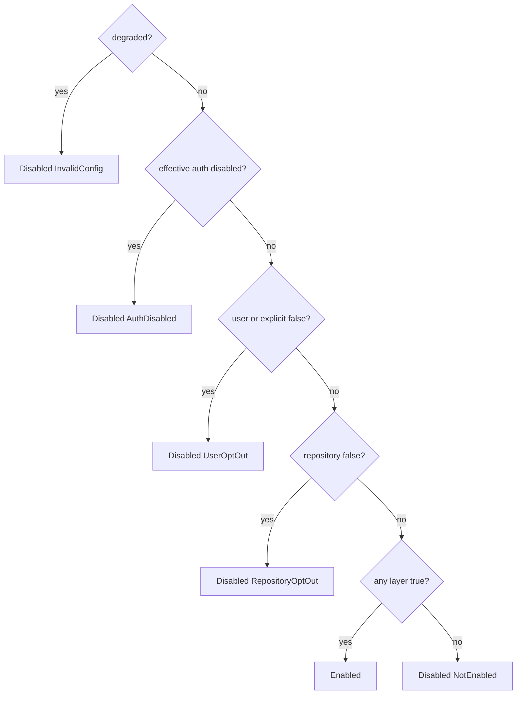

# Effective Access Policy

## Scope

This file describes how the CLI turns the per-layer `auth.mode` and `telemetry.enabled` config values into one effective access policy (`ResolvedAccessPolicy`). Key syntax and schema validation are in [config precedence contract](config-precedence-contract.md). The precedence model is recorded in [ADR: consent-gated access policy precedence](../decisions/2026-10-20-consent-gated-access-policy-precedence.md); its user-side-only consent rule is superseded by [ADR: repository telemetry.enabled grants consent](../decisions/2026-10-22-repository-telemetry-enabled-grants-consent.md).

Status: the resolver computes and exposes the policy, and `sce config show` / `validate` report it (see [Reporting](#reporting)). Managed telemetry startup, `sce doctor`'s managed-telemetry and auto-sync health, the hidden `sce auth telemetry-headers` helper, `sce auth login` / `whoami`, `sce sync`, and post-commit auto-sync enforce the policy (see [Enforcement](#enforcement)). Interactive `sce setup` is the writer for the user layer's access keys (see [Setup](#setup)).

## Terms

- **Auth mode** (`AuthMode`): `disabled | optional | mandatory`. Omitted means `optional`.
- **Policy layer** (`PolicyLayer`): how a config file is classified for access policy.
  - **User layer:** the `DefaultDiscoveredGlobal` file.
  - **Repository layer:** the `DefaultDiscoveredLocal` file, `.sce/config.json` at the enclosing Git worktree root (see [Repository discovery](#repository-discovery)).
  - **Explicit layer:** the single file selected with `--config` (`Flag`) or `SCE_CONFIG_FILE` (`Env`). It is loaded in addition to the discovered files, never instead of them.
  - **User side:** the user layer and the explicit layer together. A user-side `false` is a `user_opt_out`. Any layer, including the repository layer, can grant telemetry consent.
  - Neither key has an environment-variable or CLI-flag layer of its own.
- **Effective access policy** (`ResolvedAccessPolicy`), with these fields:
  - `auth_mode`: the effective mode, with the deciding layer as its source.
  - `telemetry_enabled`: the configured value of the layer that decided the effective state, with its provenance.
  - `telemetry`: the effective state, `TelemetryPolicyState` (`Enabled`, or `Disabled(reason)`).
  - `background_cloud_allowed`.
- **Degraded:** at least one default-discovered file was skipped as invalid.
- **Setup global access preferences** (`AccessPreferences`, read by `read_global_access_preferences`): the `auth.mode` / `telemetry.enabled` values in the global user config that interactive setup reads to suppress its access prompts and writes from new answers. Read as `Missing`, `Valid { auth_mode, telemetry_enabled }` (an absent key means not asked yet), or `Invalid`. See [Setup](#setup).

## Repository discovery

`resolve_config_paths` locates the repository layer at `enclosing_repository_root_with(cwd, path_exists)` (`cli/src/services/default_paths.rs`): the nearest ancestor of the working directory, inclusive, that contains a `.git` entry (directory or file). That is the worktree root for ordinary repositories, linked worktrees, and submodules; in a nested repository it is the innermost repository. Outside a Git repository it falls back to the working directory. The walk only probes the filesystem, so no Git subprocess runs on hook paths. `GIT_DIR` / `GIT_WORK_TREE` are not consulted. `repository_id_for` (the headers helper's repository identity) uses the same helper, so policy and repository identity always describe the same root.

Every consumer goes through this one resolver, so running from the repository root or any subdirectory yields the same effective policy: startup and managed telemetry, `sce auth login` / `whoami`, `sce auth telemetry-headers`, `sce sync`, post-commit auto-sync, `sce doctor`, and `sce config show` / `validate`.

## Explicit config files

`--config` / `SCE_CONFIG_FILE` select one explicit file. The loaded paths are, in order: the global file (if present), the repository file (if present), then the explicit file.

- **Ordinary keys** (logging, Agent Trace, `otel`, `policies`, `integrations`, `workos_client_id`, `control_plane_base_url`) come only from the explicit file, as before. The discovered files contribute nothing to them.
- **Access-policy keys** (`auth.mode`, `telemetry.enabled`) are read from every loaded layer. The explicit layer can add a restriction or grant consent, but cannot lift a global or repository restriction.
- An invalid explicit file stays fatal. An invalid discovered file is skipped and degrades the policy exactly as without an explicit file, so an unreadable global opt-out can never be bypassed by `--config`.

## Resolution

`resolve_runtime_config_with` records each parsed layer's `auth_mode` / `telemetry_enabled` into a user, repository, or explicit `AccessPolicyLayer` during the merge loop. It then calls the pure `resolve_access_policy(user, repository, explicit, degraded)` (`cli/src/services/config/resolver.rs`).

- **Auth mode:** the most restrictive layer wins (`disabled > mandatory > optional`).
  - The source is the deciding layer. Layers are compared in the order user, repository, explicit; on a tie the later layer is the source.
  - When no layer sets it, the result is `optional` with `source: default`.
- **`telemetry_enabled` value** (`resolve_telemetry_enabled`): the first `false` in the order explicit, user, repository; otherwise the first `true` in the order explicit, repository, user; otherwise `false` with `source: default`. Its source is therefore the layer that decided the opt-out or consent.
- **`background_cloud_allowed`:** `!auth_disabled && !degraded`.
- **Helpers:**
  - `telemetry_enabled()` is true only for `Enabled`.
  - `auth_allowed()` is true when the mode is not `disabled`.
  - `auto_sync_allowed(configured)` is `configured && background_cloud_allowed`.
  - `auth_disabled_config_file()` returns the `AuthPolicyConfigFile` of the deciding layer when the mode is `disabled`, otherwise `None`. Every `auth.disabled_by_config` rejection uses it.
- **Explicit config files:** an invalid explicit config file stays fatal, so it never produces a degraded policy.

### Precedence examples

| Global | Repository | Explicit | Effective |
|---|---|---|---|
| `telemetry.enabled: false` | absent | `telemetry.enabled: true` | telemetry disabled (`user_opt_out`) |
| `auth.mode: disabled` | absent | `auth.mode: optional` | auth `disabled` (source global), telemetry `auth_disabled` |
| `telemetry.enabled: true` | `telemetry.enabled: false` | `telemetry.enabled: true` | telemetry disabled (`repository_opt_out`) |
| `auth.mode: optional` | `auth.mode: disabled` | `auth.mode: mandatory` | auth `disabled` (source repository) |
| `telemetry.enabled: false` | `telemetry.enabled: true` | `telemetry.enabled: true` | telemetry disabled (`user_opt_out`) |
| absent | absent | `auth.mode: mandatory`, `telemetry.enabled: true` | auth `mandatory` (source explicit), telemetry enabled |
| absent | `telemetry.enabled: true` | absent | telemetry enabled (source repository) |
| invalid | absent | `telemetry.enabled: true` | telemetry disabled (`invalid_config`), no background cloud |

## Contradiction warnings

The resolver appends these fixed strings to `validation_warnings`, after the bash-policy redundancy warnings, in this order:

1. Any layer has `telemetry.enabled: true` while the effective auth is `disabled`:
   `telemetry.enabled is true but auth.mode resolves to disabled; SCE telemetry is disabled.`
2. `agent_trace.auto_sync` resolves `true` while the effective auth is `disabled`:
   `agent_trace.auto_sync is true but auth.mode resolves to disabled; post-commit auto-sync is skipped.`
3. Repository `mandatory` while the user or explicit layer is `disabled`:
   `auth.mode is mandatory in the repository config but disabled in the user config; auth.mode resolves to disabled.`
4. Explicit `auth.mode` less restrictive than the effective mode:
   `auth.mode in the explicitly selected config is less restrictive than the global or repository config; the most restrictive auth.mode applies.`
5. Explicit `telemetry.enabled: true` while the global or repository layer is `false`:
   `telemetry.enabled is true in the explicitly selected config but false in the global or repository config; SCE telemetry is disabled.`
6. Degraded:
   `A discovered config file was skipped as invalid; SCE telemetry and background cloud operations are disabled.`

Each string is a `WARNING_*` constant in `resolver.rs`. The skipped file's own error still appears in `validation_errors`.

## Reporting

`sce config show` reports the policy (`cli/src/services/config/render.rs`).

- **Text:** four lines directly after `agent_trace.auto_sync` and before `otel.*`:
  - `- auth.mode: <mode> (source: …[, config_source: …])` (the effective mode and its deciding layer)
  - `- telemetry.enabled: <bool> (source: …[, config_source: …])` (the deciding layer's configured value)
  - `- telemetry.effective: enabled`, or `- telemetry.effective: disabled (reason: <reason>)`
  - only when disabled with reason `not_enabled`: `- telemetry.note: Set telemetry.enabled: true in the repository SCE config to enable SCE telemetry for this repository. Claude Code telemetry settings written by sce setup are removed by the next sce setup run after the global SCE config sets telemetry.enabled to false or auth.mode to disabled; repository-level opt-outs leave them in place.`
  - only when disabled with any other reason: `- telemetry.note: Claude Code telemetry settings written by sce setup are removed by the next sce setup run after the global SCE config sets telemetry.enabled to false or auth.mode to disabled; repository-level opt-outs leave them in place.`
- **JSON:** `result.resolved.auth.mode` and `result.resolved.telemetry.enabled` use the usual `{value, source, config_source}` shape. `result.resolved.telemetry.effective` is `{state, reason}`, where `reason` is `null` when the state is enabled. `result.resolved.telemetry.note` is the same fixed note string as the text line, or `null` when enabled.
- **Reason strings** (`TelemetryDisabledReason::as_str`): `not_enabled`, `user_opt_out`, `repository_opt_out`, `auth_disabled`, `invalid_config`.
- **Warnings:** the contradiction warnings appear in `show` warnings after any `Skipped invalid config: …` entries. In `validate` they appear in `warnings` / `Validation warnings`. `validate` adds no policy fields.

The note documents a coverage limit: a repository or explicit-layer opt-out does not remove Claude-native telemetry settings already written to user-level Claude settings. Only a global withdrawal does, on the next `sce setup` run (see Enforcement).

## Setup

Interactive `sce setup` saves its auth-mode and telemetry-consent answers only to the global user config (the user layer), before any repository write. It never writes them to the repository or explicit layers ([ADR](../decisions/2026-10-21-setup-writes-access-answers-to-user-layer-only.md)). Setup does not change this resolver's precedence: after the install it re-resolves the policy and reports the effective state, so repository and explicit restrictions still win. A saved global value suppresses its prompt on reruns and changes only through `sce setup --reconfigure`, which shows it as the default. The write, its failure handling, and the `SCE access` report are described in [setup local bootstrap: global access preferences](../sce/setup-repo-local-config-bootstrap.md#global-access-preferences).

Setup then enforces the re-resolved mode with a login step: it never logs in under effective `disabled`, logs in under `optional` only when the user accepted the login offer, and always logs in under `mandatory`. A failed mandatory login exits with `auth.setup_login_required`. See [setup login](../sce/setup-repo-local-config-bootstrap.md#setup-login).

## Exposure

`ResolvedAuthRuntimeConfig`, `ResolvedHookRuntimeConfig`, and `ResolvedObservabilityRuntimeConfig` each carry `access_policy`, cloned from the same resolution that produced the rest of the projection. No consumer resolves config a second time to get the policy.

## Enforcement

- **Managed telemetry startup** (commands and admitted Claude hooks): `cli/src/app.rs` takes `telemetry_enabled()` from the startup `ResolvedObservabilityRuntimeConfig`. When telemetry is not `Enabled`, `RuntimeTelemetry::resolve` returns Noop with fallback reason `disabled_by_config` (logged at `debug`). This happens before `auth.db` is opened or the credential store is touched. See [telemetry credential](../sce/telemetry-credential.md).
- **`sce doctor` managed-telemetry health:** doctor resolves the policy for the inspected repository root. A resolution failure counts as not enabled. When telemetry is not `Enabled`, it reports `[PASS] Managed telemetry (disabled by config)` (JSON `state` / `reason` `disabled_by_config`). It may check whether `auth.db` exists (for the opt-in note), but never opens it or touches the credential store. See [telemetry credential: doctor health check](../sce/telemetry-credential.md#doctor-health-check).
- **`sce auth telemetry-headers`** (Claude's `otelHeadersHelper`): the helper resolves the policy from its working directory through `resolve_auth_runtime_config`. A missing working directory or a resolution failure counts as not enabled. When telemetry is not `Enabled`, it fails closed with the existing fixed `Telemetry credential is unavailable.` diagnostic and empty stdout. This happens before the destination tripwire, the `auth.db` existence check, repository resolution, and the `auth.db` lookup. See [telemetry credential: hidden header helper](../sce/telemetry-credential.md#hidden-header-helper).
- **`sce setup` Claude telemetry install:** with the Claude target selected, setup resolves the policy for the setup repository root through `resolve_auth_runtime_config`. A resolution failure counts as not enabled. When telemetry is not `Enabled`, it skips the Claude-native install with the fixed line `Claude telemetry: skipped; SCE telemetry is disabled by config.` and leaves user Claude settings unchanged. The exception is a withdrawal in the global user config itself (`telemetry.enabled: false` or `auth.mode: disabled`, read with `read_global_access_preferences`, never the effective reason): setup then removes the SCE-owned Claude settings, in every interactive run and in non-interactive runs with Claude selected. See [telemetry credential: Claude-native telemetry](../sce/telemetry-credential.md#claude-native-telemetry).
- **`sce auth login` / `sce auth whoami`:** both resolve the policy from the working directory through `resolve_auth_runtime_config` and check `auth_allowed()` before any `token_storage` call. A resolution failure is a command error.
  - Under `disabled`, both fail with `UserError::AuthDisabledByConfig` (key `auth.disabled_by_config`, runtime class, exit code 4) before `auth.db` or the credential store is touched. The fixed message names `auth.mode: disabled` and the config file of the deciding layer: the global SCE config, the repository `.sce/config.json`, the `--config` file, or the `SCE_CONFIG_FILE` file (`AuthPolicyConfigFile`). It tells the user to set `auth.mode` to `optional` or `mandatory` there.
  - Login provisions a telemetry credential only when telemetry is `Enabled`. Otherwise `telemetry_provisioning` is `disabled`, with the fixed message ``Telemetry credential provisioning is disabled by SCE config. Set `telemetry.enabled: true` in the global SCE config to enable it.``, shown in text as a `Note:` line. Disabled provisioning issues nothing and enrolls no repository.
  - Under `mandatory`, `whoami` without stored credentials fails with `auth.not_authenticated`. Under `optional`, it renders the unauthenticated success report as before.
- **`sce auth logout`:** performs no policy check in any mode, so it still deletes both stored credential rows under `disabled`. A later telemetry lookup classifies the missing row as `not_configured`.
- **`sce sync`:** resolves the policy from the repository root before it resolves Agent Trace storage or builds the control-plane client. Under `disabled` it fails with `auth.disabled_by_config` (same message and deciding-file naming as login), so `auth.db` and the credential store are never reached. `optional` and `mandatory` keep the existing behavior. See [sync command: error classification](sync-command.md#error-classification).
- **Post-commit auto-sync:** the hook launches `sce sync` only when `auto_sync_allowed(agent_trace.auto_sync)` holds, so auth `disabled` or a degraded config suppresses the launch. A suppressed launch is silent apart from a `debug` log, and the hook still succeeds. See [automatic Agent Trace synchronization](agent-trace-auto-sync.md#trigger-boundary).
- **`sce doctor` auto-sync row:** `post_commit_auto_sync.enabled` is the effective value (`auto_sync_allowed` of the configured value). When the policy suppresses auto-sync, the row reports state `disabled`. `source` / `config_source` still describe `agent_trace.auto_sync`.
