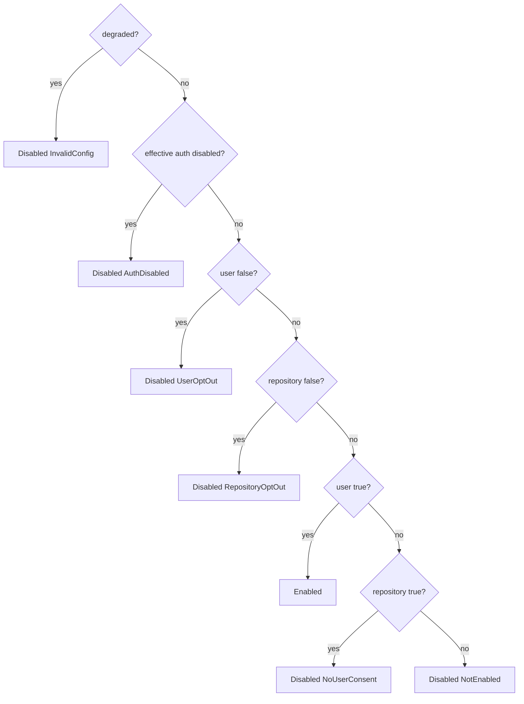

# Effective Access Policy

## Scope

This file describes how the CLI turns the per-layer `auth.mode` and `telemetry.enabled` config values into one effective access policy (`ResolvedAccessPolicy`). Key syntax and schema validation are in [config precedence contract](config-precedence-contract.md). The precedence model is recorded in [ADR: consent-gated access policy precedence](../decisions/2026-10-20-consent-gated-access-policy-precedence.md).

Status: the resolver computes and exposes the policy, and `sce config show` / `validate` report it (see [Reporting](#reporting)). Managed telemetry startup and `sce doctor`'s managed-telemetry health enforce the telemetry state (see [Enforcement](#enforcement)). The headers helper, auth commands, sync, auto-sync, and setup do not enforce the policy yet.

## Terms

- **Auth mode** (`AuthMode`): `disabled | optional | mandatory`. Omitted means `optional`.
- **Policy layer** (`PolicyLayer`): how a config file is classified for access policy.
  - **User layer:** a `DefaultDiscoveredGlobal` file, or the single explicit file (`Flag` / `Env`).
  - **Repository layer:** a `DefaultDiscoveredLocal` file (`<cwd>/.sce/config.json`).
  - Neither key has an environment-variable or CLI-flag layer.
- **Effective access policy** (`ResolvedAccessPolicy`), with these fields:
  - `auth_mode`: the effective mode, with the deciding layer as its source.
  - `telemetry_enabled`: the configured merged value with its provenance.
  - `telemetry`: the effective state, `TelemetryPolicyState` (`Enabled`, or `Disabled(reason)`).
  - `background_cloud_allowed`.
- **Degraded:** at least one default-discovered file was skipped as invalid.

## Resolution

`resolve_runtime_config_with` records each parsed layer's `auth_mode` / `telemetry_enabled` into a user or a repository `AccessPolicyLayer` during the merge loop. It then calls the pure `resolve_access_policy(user, repository, degraded)` (`cli/src/services/config/resolver.rs`).

- **Auth mode:** the most restrictive layer wins (`disabled > mandatory > optional`).
  - The source is the deciding layer. When both layers carry the same mode, the repository layer is the source.
  - When neither layer sets it, the result is `optional` with `source: default`.
- **`telemetry_enabled` value:** the repository value if set, otherwise the user value, otherwise `false` with `source: default`. This is the configured value, not the effective state.
- **`background_cloud_allowed`:** `!auth_disabled && !degraded`.
- **Helpers:**
  - `telemetry_enabled()` is true only for `Enabled`.
  - `auth_allowed()` is true when the mode is not `disabled`.
  - `auto_sync_allowed(configured)` is `configured && background_cloud_allowed`.
- **Explicit config files:** an invalid explicit config file stays fatal, so it never produces a degraded policy.

## Contradiction warnings

The resolver appends these fixed strings to `validation_warnings`, after the bash-policy redundancy warnings, in this order:

1. Repository `telemetry.enabled: true` without a user-layer `true`:
   `telemetry.enabled is true in the repository config but not in the user config; SCE telemetry stays disabled until the user config sets telemetry.enabled to true.`
2. Any layer has `telemetry.enabled: true` while the effective auth is `disabled`:
   `telemetry.enabled is true but auth.mode resolves to disabled; SCE telemetry is disabled.`
3. `agent_trace.auto_sync` resolves `true` while the effective auth is `disabled`:
   `agent_trace.auto_sync is true but auth.mode resolves to disabled; post-commit auto-sync is skipped.`
4. Repository `mandatory` while the user layer is `disabled`:
   `auth.mode is mandatory in the repository config but disabled in the user config; auth.mode resolves to disabled.`
5. Degraded:
   `A discovered config file was skipped as invalid; SCE telemetry and background cloud operations are disabled.`

Each string is a `WARNING_*` constant in `resolver.rs`. The skipped file's own error still appears in `validation_errors`.

## Reporting

`sce config show` reports the policy (`cli/src/services/config/render.rs`).

- **Text:** four lines directly after `agent_trace.auto_sync` and before `otel.*`:
  - `- auth.mode: <mode> (source: …[, config_source: …])` (the effective mode and its deciding layer)
  - `- telemetry.enabled: <bool> (source: …[, config_source: …])` (the configured merged value)
  - `- telemetry.effective: enabled`, or `- telemetry.effective: disabled (reason: <reason>)`
  - only when disabled: `- telemetry.note: Claude Code telemetry settings written by earlier sce setup runs are not changed by telemetry.enabled.`
- **JSON:** `result.resolved.auth.mode` and `result.resolved.telemetry.enabled` use the usual `{value, source, config_source}` shape. `result.resolved.telemetry.effective` is `{state, reason}`, where `reason` is `null` when the state is enabled. `result.resolved.telemetry.note` is the fixed note string, or `null` when enabled.
- **Reason strings** (`TelemetryDisabledReason::as_str`): `not_enabled`, `user_opt_out`, `no_user_consent`, `repository_opt_out`, `auth_disabled`, `invalid_config`.
- **Warnings:** the contradiction warnings appear in `show` warnings after any `Skipped invalid config: …` entries. In `validate` they appear in `warnings` / `Validation warnings`. `validate` adds no policy fields.

The note documents a coverage limit: telemetry opt-out does not remove Claude-native telemetry settings already written to user-level Claude settings.

## Exposure

`ResolvedAuthRuntimeConfig`, `ResolvedHookRuntimeConfig`, and `ResolvedObservabilityRuntimeConfig` each carry `access_policy`, cloned from the same resolution that produced the rest of the projection. No consumer resolves config a second time to get the policy.

## Enforcement

- **Managed telemetry startup** (commands and admitted Claude hooks): `cli/src/app.rs` takes `telemetry_enabled()` from the startup `ResolvedObservabilityRuntimeConfig`. When telemetry is not `Enabled`, `RuntimeTelemetry::resolve` returns Noop with fallback reason `disabled_by_config` (logged at `debug`). This happens before the readiness hint is read, `auth.db` is opened, or the credential store is touched. See [telemetry credential](../sce/telemetry-credential.md).
- **`sce doctor` managed-telemetry health:** doctor resolves the policy for the inspected repository root. A resolution failure counts as not enabled. When telemetry is not `Enabled`, it reports `[PASS] Managed telemetry (disabled by config)` (JSON `state` / `reason` `disabled_by_config`). It may check whether the readiness hint file exists, but never reads it or touches `auth.db`. See [telemetry credential: doctor health check](../sce/telemetry-credential.md#doctor-health-check).
