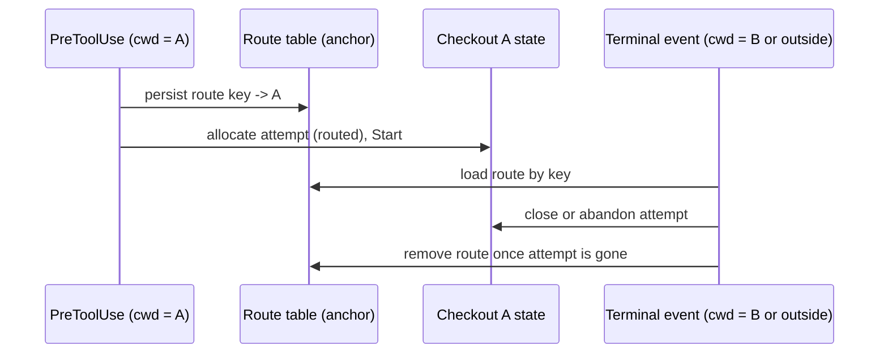

# Claude mutation-scope route store

The Claude mutation-scope adapter has a durable route store in
`cli/src/services/hooks/claude_mutation_scope/routes.rs`. A route records the
checkout where one tracked Claude tool invocation started. Terminal hook events
can use the route to reach that checkout after the hook `cwd` has changed, for
example after `cd` into a nested Git repository.

`lifecycle.rs` uses the store for every tracked tool execution. See
[Lifecycle routing](#lifecycle-routing). The decision record is
[`2026-11-24-claude-mutation-scope-routes-bind-tools-to-pretooluse-checkout.md`](../decisions/2026-11-24-claude-mutation-scope-routes-bind-tools-to-pretooluse-checkout.md).

## Route anchor

The route anchor is the Git directory of `CLAUDE_PROJECT_DIR`, resolved with
`git rev-parse --absolute-git-dir`. A live Claude Code probe showed that this
value stays the same across `cwd` changes, subagent events, and terminal events.
The event `cwd` and its Git directory do not stay the same.

The anchor only locates the route table. It never identifies a mutation target.
`resolve_route_anchor` returns a typed `RouteAnchorError`:

- `ProjectDirUnset`: `CLAUDE_PROJECT_DIR` is missing or blank.
- `Unresolvable`: `CLAUDE_PROJECT_DIR` does not resolve to a Git directory.

The store never falls back to the event `cwd` when the anchor is unavailable.

## Route table

The route table is `<anchor-git-dir>/sce/claude-mutation-scope-routes.json`. It
is separate from the checkout-local `claude-mutation-scope-state.json`. Its shape
is a versioned `{version, routes[]}`. Each route has the full attempt key
(`session_id`, optional `agent_id`, `tool_use_id`) and a target
(`checkout_path`, `git_dir`). The route table is adapter bookkeeping. It is not
attribution evidence, and a route never proves that a scope started.

Writes hold `<anchor-git-dir>/sce/claude-mutation-scope-routes.lock` and use the
durability sequence: temp file, `sync_data`, atomic rename, and a directory
sync on Unix. A failure to open or `sync_all` the directory fails the write with
the directory path in the error, so `PreToolUse` denies the tool. Such a failure
happens after the rename, so the new table can stay visible on disk. A retried
`persist_route` for the same key and target returns `AlreadyRouted` only after
it syncs the directory again. A route left visible without an attempt is
retired by the next terminal or cleanup event of that session. A malformed or
wrong-version table is rejected and never overwritten.

## Operations

| Operation | Behavior |
| --- | --- |
| `persist_route` | `Inserted` for a new key. `AlreadyRouted` for a replay with the same target. `Conflict { existing }` for a different target; the live route is not changed. |
| `load_route` | Returns the target for the exact attempt key, or none. |
| `routes_for_session` | Returns every route of one `session_id`. |
| `remove_route` | `Removed` only while the route still has the expected target. `TargetMismatch` leaves a route for a reused `tool_use_id` intact. `Absent` makes a duplicate removal safe. |

Main-agent and subagent keys with the same `tool_use_id` are distinct routes.
The route lock and the checkout-state lock are separate files.

## Lifecycle routing

- `PreToolUse` resolves the anchor, then the canonical worktree root of the
  `cwd` (`resolve_worktree_root`), then the Git directory of that root, then
  runs the recovery barrier. Resolving the Git directory from the root keeps
  both target fields in one checkout, including linked worktrees and nested
  repositories. The route stores the root, not the `cwd`, so a tool may delete
  or rename its starting subdirectory. A root that cannot be resolved denies
  the tool. It persists the route before attempt allocation
  and `Start`. An unresolvable anchor, a persist failure, or a `Conflict` denies
  the tool with the standard fail-closed decision.
- `PostToolUse`, `PostToolUseFailure`, and `PermissionDenied` load the route and
  finish the attempt in the route's `git_dir`, passing the route's
  `checkout_path` to the seam. A route without an attempt is removed with no
  seam call.
- `Stop`, `StopFailure`, `UserPromptSubmit`, `SubagentStop`, and `SessionEnd`
  read the session's routes, filter them by the event's agent rule, and run the
  shared cleanup once per recorded target. A failure on one target does not
  stop the other targets.
- `WorktreeRemove` cleans the event's `worktree_path` as before, then retires
  the session's routes into that worktree.
- A route is removed only when its attempt no longer exists in the target
  state. A failed close or abandon keeps the route, so a later event can retry.

## Legacy attempts and unresolved routes

New adapter attempts carry `routed: true`. A state file written before routing
has no `routed` field, and its attempts load as `routed: false`. Only these
legacy attempts may be found through the event `cwd` when no route exists. A
legacy lookup whose `cwd` is outside every repository is a no-op.

When a terminal or cleanup event cannot resolve the anchor or read the route
table, it logs `sce.hooks.claude_mutation_scope.route_unresolved` and acts only
on legacy attempts. A routed attempt whose route is missing is never closed or
abandoned through the event `cwd`. A legacy attempt whose `cwd` changed before
completion keeps the original orphaned-scope limitation.

## Remaining limits

- A scope binds to its `PreToolUse` checkout. A tool that starts in nested
  repository B and then mutates parent repository A (for example
  `cd .. && echo x > file`) closes its scope in B. A's change has no scope in
  A. A's next boundary records it as unscoped.
- A route left by a start that failed after route persistence is removed only
  by a later terminal or cleanup event of that session. When Claude exits
  without such an event, the route stays as inert bookkeeping. It never closes
  or abandons a scope by itself.
- A `PreToolUse` for the same key can arrive between a terminal event's attempt
  check and its route removal. That attempt can then stay unrouted. Claude does
  not reuse a live `tool_use_id` concurrently.

## Live validation and overhead

A live Claude Code 2.1.309 session used disposable repository A with nested
repository B. It ran Bash tools whose `cwd` changed from A to B, and from B to
A, inside one tool. Every scope ended `closed` in the Agent Trace DB of its
`PreToolUse` repository, with its `close` event in that worktree. No scope
stayed `active`, the route table ended empty, and neither adapter state had
`recovery_pending` set.

Routing adds one anchor `git rev-parse` and one locked, fsynced route-table
write to each tracked `PreToolUse` and terminal event. On a debug build, the
measured median cost was about 15 ms per `PreToolUse` and 25 ms per
`PostToolUse`.

## Related context

- [Claude mutation-scope integration](claude-mutation-scope-integration.md)
