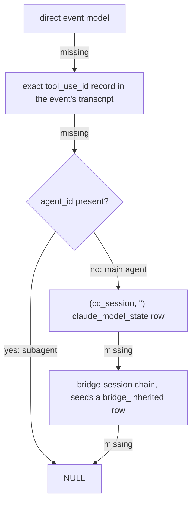

# Claude Model Resolver

`cli/src/services/hooks/claude_model_resolver.rs` is the one module that resolves
the model of a Claude hook event. Decision:
[`2026-11-23-claude-subagent-attribution`](../decisions/2026-11-23-claude-subagent-attribution.md).

## Evidence

The resolver takes one concrete `ClaudeModelEvidence` struct:

- `session_id`: the canonical `cc_<session_id>`.
- `agent_id`: present only for a subagent event.
- `tool_use_id`, `transcript_path`, and `direct_model_id`: copied from the event.

The module adds no trait, provider interface, or injection seam.

## Entry points

- `resolve_claude_model(db, evidence)` runs the full chain.
- `resolve_claude_model_from_exact_evidence(evidence)` runs only the direct
  model step and the exact-record step. It has no database access.

Each model source is normalized once with the `claude/` prefix.

## Main-agent precedence

An event without `agent_id` resolves in this order:

1. The direct event model.
2. The exact `tool_use_id` record in the main transcript.
3. The exact `(cc_<session_id>, "")` `claude_model_state` row.
4. The bridge-session chain. On a hit, the resolver writes one
   `claude_model_state` row for the session with `source="bridge_inherited"`.
   This is the only write the resolver makes.
5. `NULL`.

## Subagent precedence

An event with `agent_id` resolves in this order:

1. The direct event model.
2. The exact `tool_use_id` record in the subagent transcript.
3. `NULL`.

A subagent event never reads `claude_model_state`, never uses the bridge-session
chain, and writes no state row. A record that does not name the event's
`tool_use_id` never attributes the event. After a model switch, each event
resolves to the model on its own tool-call record. An event whose record is not
yet written resolves to `NULL`.

## Subagent transcript path

`claude_subagent_transcript_path` is the one function that derives the subagent
transcript path:
`<dirname(transcript_path)>/<session_id>/subagents/agent-<agent_id>.jsonl`.
When the event `transcript_path` already names that file, the function returns
it unchanged. The function returns no path when the session ID (without `cc_`)
or the `agent_id` contains a character outside `[A-Za-z0-9_-]`.

## Transcript bounds

`claude_transcript::find_claude_transcript_tool_use_model` reads the transcript.
Its generic core `find_tool_use_model_in<R: Read + Seek>` serves fixture tests.

- It scans at most the last 4 MiB (`CLAUDE_TRANSCRIPT_TAIL_WINDOW_BYTES`). The
  scan starts at the first complete record inside that window.
- It skips a record longer than 1 MiB (`CLAUDE_TRANSCRIPT_MAX_RECORD_BYTES`)
  without buffering it, and continues with the next record.
- It skips a record that is not valid UTF-8 JSON and continues.
- It returns the model of the first assistant record whose content has a
  `tool_use` block with the event's `tool_use_id`.
- It reports an open, seek, or read failure as `ClaudeTranscriptReadError`. The
  resolver maps every reader error to `NULL`.

A lookup reads no more than the window plus one capped record. An exact record
more than 4 MiB from the end, or longer than 1 MiB, resolves to `NULL` at the
transcript step. A main-agent event then continues to the state and bridge
steps.

## Consumers

- Structured Claude `diff-trace` keeps only the direct model at parse time. At
  persist time it calls `resolve_claude_model` once per event. See
  [agent-trace-hooks-command-routing.md](./agent-trace-hooks-command-routing.md).
- Mutation-scope provenance admission does not use the resolver. It calls
  `claude_model_state_by_session_and_agent` directly in
  `claude_mutation_scope/lifecycle.rs`.
