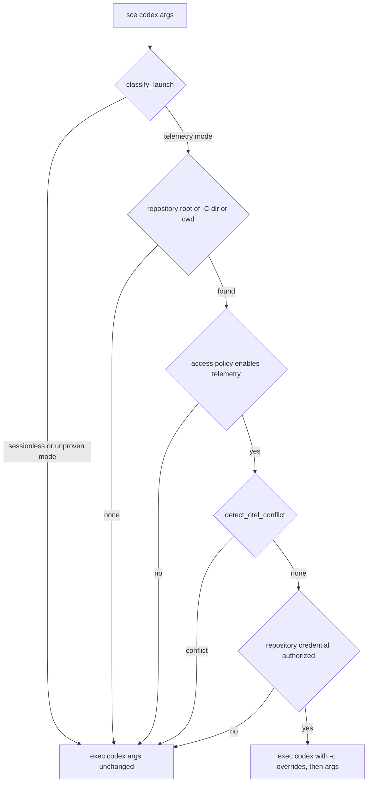

# Codex native telemetry launcher

`sce codex [codex arguments...]` launches Codex CLI with Codex's own OpenTelemetry export pointed at the managed collector. The export uses a repository-scoped telemetry credential. A plain `codex` launch exports no native telemetry. SCE Codex hook spans are independent of the launcher (see [cli-observability-contract.md](cli-observability-contract.md#managed-trace-export)).

Code: `cli/src/services/codex_telemetry/` (`mod.rs` for classification, conflict detection, and overrides; `command.rs` for execution). Decision: [ADR](../decisions/2026-11-24-codex-native-telemetry-via-sce-codex-launcher.md). Probe evidence for Codex 0.172.0: [codex-native-telemetry-contract.md](codex-native-telemetry-contract.md).

## Launch flow

- Every plain launch except the sessionless and policy-disabled cases prints one stderr line: `sce: launching Codex without SCE native telemetry: <reason>.`
- The launcher must not change the caller's arguments. Overrides are prepended. Arguments, including `--help`, reach Codex verbatim.
- On Unix the launcher replaces itself with `codex` (`exec`), so the terminal, signal delivery, and the Codex exit code are Codex's own. On other platforms it waits for `codex` and exits with its status. A missing `codex` binary fails with `Failed to launch `codex``.
- The launcher never initializes managed exporter telemetry (`managed_span_kind` returns no span kind for `sce codex`).

## Invocation modes

| Mode | Native telemetry |
| --- | --- |
| New interactive session, with or without a prompt | Yes |
| `exec`, `e`, `exec fork` | Yes |
| `resume`, `exec resume` with `-C <dir>` (before or after the subcommand) | Yes; the repository comes from `<dir>` |
| `resume`, `exec resume` without `-C` | No; the session runs in its stored directory |
| Interactive `fork` | No; the directory is chosen after launch |
| `app-server`, `exec-server`, `remote-control`, `cloud`, `mcp`, `mcp-server`, `review`, `exec review` | No; unproven |
| `login`, `logout`, `completion`, `features`, `apply`, `sandbox`, `debug`, `help`, `-h`, `--help`, `-V`, `--version` | No; sessionless, without a notice |
| An option the launcher does not recognize | No; the value boundary is unknown |

`-C`/`--cd` sets the launch directory, resolved against the process working directory. The repository root is the nearest ancestor with a `.git` entry.

## Conflict detection

The launcher skips native telemetry when any of the following holds. It never overwrites the conflicting source.

- A non-canonical `OTEL_EXPORTER_OTLP_ENDPOINT`, per-signal endpoint, or `BETA_TRACING_ENDPOINT` is set (the same tripwire as the header helper).
- A caller `-c`/`--config` override has the key `otel` or `otel.*`.
- `CODEX_HOME` (else `~/.codex`) cannot be determined.
- `$CODEX_HOME/config.toml` defines `otel.exporter`, `otel.trace_exporter`, `otel.metrics_exporter`, or `otel.headers_helper`.
- The selected profile defines one of those keys. The profile comes from `--profile`/`-p`, else the config `profile` key. The launcher checks `[profiles.<name>.otel]` in `config.toml` and `$CODEX_HOME/<name>.config.toml`.
- The user config or the selected profile file cannot be read or parsed.
- A readable `/etc/codex/requirements.toml`, `/etc/codex/managed_config.toml`, or `/etc/codex/config.toml` has an `otel` key, or cannot be parsed. An unreadable system file is not a conflict.

## Overrides

When telemetry is enabled, the launcher passes these process-local `-c` overrides before the caller's arguments:

| Key | Value |
| --- | --- |
| `otel.headers_helper` | `'<sce executable>' auth telemetry-headers --repo '<repository root>'` (single-quoted for `sh -c`) |
| `otel.headers_helper_refresh_interval_ms` | `300000` |
| `otel.exporter` | `"none"`: native logs stay off |
| `otel.trace_exporter` | `{otlp-http={endpoint="https://otel.crocoderlab.dev/v1/traces",protocol="binary"}}` |
| `otel.metrics_exporter` | `{otlp-http={endpoint="https://otel.crocoderlab.dev/v1/metrics",protocol="binary"}}` |
| `otel.log_user_prompt`, `otel.log_agent_responses`, `otel.log_guardian_assessments` | `false` |

- No override carries a credential or static headers. Codex obtains the bearer from the helper ([telemetry-credential.md](telemetry-credential.md#hidden-header-helper)).
- No Codex config file is written.

## Limits

- Coverage is limited to `sce codex` launches.
- Threads that change directory inside one Codex process (subagents, `/new`, in-TUI resume) stay attributed to the launch repository.
- MDM and cloud requirements are not readable by the launcher. A requirements layer can override the pins or force content logging.
- If the helper fails, Codex suspends export and drops data until the next successful refresh. The session itself continues.
- Codex native metrics have no session identifier and no cost signal. Token `input` includes cached input.

See also: [codex-native-telemetry-contract.md](codex-native-telemetry-contract.md), [telemetry-credential.md](telemetry-credential.md), [../context-map.md](../context-map.md)
