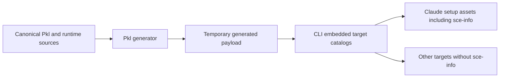

# Config generation boundary

The repository keeps no committed OpenCode, Claude, Pi, or Codex generated target trees. `config/.opencode`, `config/.claude`, `config/.pi`, `config/.agents`, and `config/.codex` are logical payload layouts emitted only beneath temporary generation roots, Cargo `OUT_DIR`, and packaging-only fallback directories.

Authored config content is standardized around one canonical Pkl source model with target-specific rendering applied later in the pipeline.

Current location for canonical workflow content primitives:

- `config/pkl/base/workflow-content.pkl` (shared workflow command and self-contained skill-package document model, including structured composite sources with optional canonical `compositeSkillBody` and `argumentDependentCommandBody` — both two-argument functions of the target's arguments-reference token and a per-workflow invocation-example string, letting skill-mode prose name the invocation input instead of a literal `$ARGUMENTS` for a target whose harness does not substitute it, and append a target-specific concrete `$sce-{slug}` example (via the shared `invocationExampleParagraph` helper, empty for a target that supplies none) immediately before `## Workflow` — plus deterministic `referenceDocuments` and an optional, similarly parameterized `argumentReferenceOutputDocument` for a workflow whose output layouts quote that same input back to the user, alongside the typed package/composite rendering primitives; workflow-specific bodies and package-local documents remain in the canonical workflow modules rather than being catalogued here)
- `config/pkl/base/workflow-catalog.pkl` (typed six-workflow catalog owning command and skill slugs, titles, descriptions, argument hints, OpenCode routing roles, Claude allowed-tool metadata, and the per-workflow `optional` flag that defaults to `false` and is `true` only for `brownfield`)
- `config/pkl/base/optional-workflow-manifest.pkl` (install-time projection of the catalog's optional records into the generated `config/optional-workflows.json` manifest — `schemaVersion` plus one entry per optional workflow carrying `id`, `title`, `description`, `commandSlug`, and `skillSlug`. Optionality never affects generation: all six workflows are still generated for all four targets, so the manifest exists solely to carry optional-workflow identity out of Pkl for install-time and doctor-time consumers)
- `config/pkl/base/decision-skill.pkl` (canonical standalone `sce-decision` package outside the workflow catalog; renders its decision gate, one-record and immutable-ADR rules, active-only reuse and creation-time status semantics, deterministic written/not-qualified/skipped/blocked handoff, and `references/adr-template.md` for all four targets without creating a command or prompt)
- `config/pkl/base/workflow-change-to-plan.pkl` (canonical `/change-to-plan` package registering the target-neutral `SKILL.md` body plus `context-load.md`, `plan-authoring.md`, `plan-template.md`, and `output.md` package references; the plan template persists task synchronization lifecycle state, retains the plan format needed by existing plans, and defines the optional structured layer of design decisions, verification scenarios, and `Decisions`/`Scenarios`/`Covers` reference fields described in `shared-context-plan-workflow.md`)
- `config/pkl/base/workflow-next-task.pkl` (canonical `/next-task` package registering the target-neutral `SKILL.md` body plus `plan-review.md`, `task-execution.md`, `context-sync.md`, `sync-report.md`, and `output.md` package references; review gates new tasks on synced lifecycle state, execution records pending before task synchronization, and the execution reference defines an explicit Git-baseline-relative handoff consumed by task synchronization)
- `config/pkl/base/workflow-validate.pkl` (canonical `/validate` package registering the target-neutral `SKILL.md` body plus `validation.md`, `validation-report.md`, and `output.md` package references; `validation.md` carries the validation steps plus the validation result contract and keeps final validation observational by recording leftover debug/temp artifacts as failure evidence rather than deleting or repairing them; `/validate` does not invoke plan-level context synchronization, and `output.md` holds the `Completion` layout)
- `config/pkl/base/workflow-commit.pkl` (canonical `/commit` package registering the target-neutral `SKILL.md` body plus `atomic-commit.md`, `commit-message-style.md`, and `output.md` package references; `atomic-commit.md` owns staged-diff procedure, internal result branching, and commit boundaries, `commit-message-style.md` owns message wording, and both regular and bypass paths read the phase reference only after their pre-phase gate)
- `config/pkl/base/workflow-context-sync.pkl` (one role-parameterized source that renders exact, self-contained task and retained plan context-sync skills in named semantic section order, gives each lifecycle role its own composite step heading scale, renders their synced, no-context-change, and blocked report layouts through shared named section renderers from typed role data, and exposes task synchronization to `/next-task` while retaining the plan role without composing it into `/validate`)
- `config/pkl/base/workflow-handover.pkl` (canonical `/handover` package with the self-contained, phase-free `sce-handover` skill; its structured composite source has no phases and exposes package-local `references/handover-template.md` plus mode-invariant `references/output.md`, so composite rendering differs from its package-mode form only by the generic composite preamble the shared renderer supplies)
- `config/pkl/base/workflow-brownfield.pkl` (canonical `/brownfield` package with the self-contained, phase-free `sce-brownfield` skill; like `workflow-handover.pkl` its structured composite source has no phases and exposes one `references/output.md` as its sole output document, and its preamble is a semantic reference so composite rendering keeps the workflow's cold-start and gap-fill scope statement the shared renderer has no generic equivalent for. It is the sixth catalog-registered workflow, composed by `workflow-composite.pkl` and generated for all four targets)
- `config/pkl/base/opencode.pkl`
- `config/pkl/base/sce-config-schema.pkl`

Current target renderer helper modules:

- `config/pkl/renderers/opencode-content.pkl`
- `config/pkl/renderers/claude-content.pkl`
- `config/pkl/renderers/workflow-composite.pkl` (target-neutral composition of six workflow-level skills and deterministic package-local references; phase-based packages consume named phase, persisted-document, and output documents from their canonical workflow modules, phase-free packages retain output layouts and may expose a persisted-format reference such as handover's template, and target differences remain frontmatter-only)
- `config/pkl/renderers/pi-content.pkl`
- `config/pkl/renderers/codex-content.pkl` (fourth target renderer: exposes `skillDocuments` from the same shared composition and the decision package with no per-target frontmatter (matching Pi) and no `commands` mapping, since Codex has no command/prompt layer, plus a per-catalog-workflow `{skillSlug}/agents/openai.yaml` document sourced from `codex-metadata.pkl` for the six catalog workflows (not `sce-decision`), plus `hooksJson`/`sceHookScript` for `.codex/hooks.json` and its fail-open install-guidance hook script, mirroring `claude-content.pkl`'s `settings`/`sceHookScript` shape)
- `config/pkl/renderers/common.pkl`
- `config/pkl/renderers/opencode-metadata.pkl`
- `config/pkl/renderers/claude-metadata.pkl`
- `config/pkl/renderers/metadata-coverage-check.pkl`
- `config/pkl/renderers/generation-contract-check.pkl`
- `config/pkl/renderers/codex-metadata.pkl` (typed Codex skill-interface metadata plus a pure `agents/openai.yaml` renderer for the six catalog workflow skills — `interface.{display_name,short_description,default_prompt}` derived from/authored alongside the catalog, and `policy.allow_implicit_invocation: false`; wired into `codex-content.pkl`'s emitted skill documents, so these six stateful lifecycle workflows are reachable only via explicit `$sce-<slug>` invocation or Codex's `/skills` discovery, not implicit conversational activation; `sce-decision` has no user-facing entrypoint on any target and receives no such file)
- `config/pkl/generate.pkl` (single multi-file generation entrypoint)
- `config/pkl/generator-inputs.txt` (machine-readable repository-relative declaration of canonical Pkl and referenced plugin/extension inputs)
- `scripts/produce-cli-generated-input.sh` (canonical generated-input producer for input discovery, two-pass evaluation, determinism and input-mutation checks, exact payload/input inventories, atomic publication, and temporary-state cleanup; consumed by the repository Cargo wrapper, generated-output check, package-fallback preparation, and Nix `cliGeneratedInput` derivation)
- `config/pkl/check-generated.sh` (dev-shell integration check that delegates deterministic generation and inventories to the producer while retaining metadata/contract fixtures, required outputs, forbidden repository generated paths, and the stray repository-local `config/pkl/rendered` evaluation artifact)
- `nix flake check` / `checks.<system>.{cli-tests,cli-clippy,cli-fmt,pkl-generated,codex-hook-command,npm-bun-tests,npm-biome-check,npm-biome-format,config-lib-bun-tests,config-lib-biome-check,config-lib-biome-format,workflow-actionlint}` plus Linux-only `flatpak-static-validation`, `cargo-sources-parity`, and `flatpak-manifest-parity` (root-flake checks for CLI behavior, ephemeral Pkl generation, Codex hook invocation, JS validation, workflow linting, and lightweight Flatpak validation)
- `config-lib-bun-tests` executes from `config/lib/` while using a repo-shaped copied source subset that also includes `cli/src/services/structured_patch/fixtures` for Claude agent-trace golden fixture coverage (fully Rust-owned; the Claude TypeScript Bun test was removed in T07).

The scaffold provides stable canonical content-unit identifiers and reusable target-agnostic text primitives for all planned authored generated classes (agents, commands, skills, shared runtime assets, OpenCode plugin entrypoints, the Pi extension entrypoint, generated OpenCode package manifests, and generated Claude project settings).

Renderer modules apply target-specific metadata/frontmatter rules while reusing canonical content bodies:

- All four renderers consume the six canonical workflow packages as behavior sources. OpenCode, Claude, and Pi emit the same six command-routed workflow packages: `sce-change-to-plan`, `sce-next-task`, `sce-validate`, `sce-commit`, `sce-handover`, and `sce-brownfield`; Codex emits the same six as skill packages only, with no command or prompt layer. Each renderer also emits the standalone internal `sce-decision` package with `SKILL.md` plus `references/adr-template.md`; it stays outside workflow composition and has no command or prompt. For the phase-based workflows, `workflow-composite.pkl` renders one `SKILL.md` that owns input parsing, phase order, branching, waits, and same-session resume, plus package-local references for each applicable phase and persisted-document format. The applicable reference must be read before its phase runs. `references/output.md` remains the sole owner of human-visible gates and terminal layouts. Phase statuses remain internal, commands and prompts still invoke exactly one workflow skill, and SCE sibling handoffs remain limited to the successful task-synchronization gate's bounded `sce-decision` invocation; `/validate` reports validation directly without a plan-synchronization handoff. Relevant non-SCE skills may help within the active step and must return control without weakening its invariants. `sce-handover` and `sce-brownfield` are phase-free; handover has a package-local persisted-format template in addition to `SKILL.md` and `references/output.md`, while brownfield retains its two-file shape. OpenCode, Claude, Pi, and Codex render identical package-relative inventories and document bodies for each workflow, apart from supported target frontmatter.
- Per-target differences are confined to frontmatter and the surrounding non-workflow outputs. The manual OpenCode renderer adds `agent`, `entry-skill`, and a one-entry `skills` list to command frontmatter, adds `compatibility: opencode` to package entrypoints, and emits two thin routing agents. Each OpenCode agent allows ordinary non-SCE skills by default, denies the `sce-*` wildcard, and then allows only its catalog-derived owned workflow skills; only the Code agent additionally allows `sce-decision` for the synchronization exception. The Claude renderer adds `compatibility: claude` plus command `allowed-tools:` and emits no agents; Claude settings and the hook helper remain separate retained outputs, with `SessionStart` and `PostModelSwitch` lifecycle registrations routed to the local model-state hook. The Pi renderer adds no frontmatter to either prompts or skills. The Codex renderer likewise adds no frontmatter and, unlike Pi, emits no `commands` mapping at all — `config/.agents` has no command/prompt directory. Codex also differs from all three other targets in the two arguments it passes `skillDocuments` beyond frontmatter: the arguments-reference token (OpenCode, Claude, and Pi pass the literal `$ARGUMENTS` their harnesses substitute, while Codex passes the plain-prose token `invocation input`, since its skill loading provides no such substitution) and a per-workflow-slug invocation-example function (empty for OpenCode, Claude, and Pi; for Codex, one authored, runnable `$sce-{slug} ...` example per catalog workflow). So Codex's `## Input` prose and its `sce-handover`/`sce-brownfield` `references/output.md` diverge from Pi's by the arguments-reference token, and every Codex skill's `## Input` section additionally carries a trailing "For example: `$sce-{slug} ...`." paragraph that Pi/Claude/OpenCode do not render.
- Pi renderer consumes the same shared workflow composition as OpenCode and Claude. It emits exactly six thin prompts to `config/.pi/prompts/{slug}.md`, each routing to exactly one workflow skill, four phase-based workflow packages with package-local phase and supporting references plus the phase-free handover and brownfield packages under `config/.pi/skills/{slug}/` (handover also has its persisted-format template), and the standalone `sce-decision` package beside them. Pi prompts and skills carry no target-specific frontmatter beyond the shared description and argument hint, so Pi passes the empty extra-frontmatter string to both package render paths. It emits no Pi agent-role prompts. Pi has no settings/plugin manifest; runtime integration remains the project-local extension emitted verbatim from `config/lib/pi-plugin/sce-pi-extension.ts` to `config/.pi/extensions/sce/index.ts` (auto-discovered by Pi, no registration manifest; see `context/sce/pi-extension-runtime.md`).
- Codex renderer consumes the same shared workflow composition and the same empty extra-frontmatter string as Pi; its `skillDocuments` output matches Pi's byte-for-byte for every shared document except where the arguments-reference token appears (`invocation input` in place of Pi's substituted `$ARGUMENTS`, in every skill's `## Input` prose and in `sce-handover`/`sce-brownfield`'s `references/output.md`) and where every skill's `## Input` section carries Codex's own trailing concrete `$sce-{slug}` invocation-example paragraph, which Pi's `skillDocuments` call passes as empty and so never renders. It emits the same four phase-based packages, the phase-free handover and brownfield packages, and the standalone `sce-decision` package under `config/.agents/skills/{slug}/`. Codex alone additionally carries `{skillSlug}/agents/openai.yaml` for each of the six catalog workflow skills (not `sce-decision`), rendered by `codex-metadata.pkl` from the same catalog `title`/`description` plus an authored `default_prompt`, with `policy.allow_implicit_invocation: false` so these stateful lifecycle workflows activate only from explicit `$sce-<slug>` invocation or `/skills` discovery, never from conversational relevance alone; no other target has an implicit-invocation policy concept. It has no `commands` map, no agents, and no settings/plugin manifest. It separately emits `.codex/hooks.json`: the four conversation/diff registrations route through `sce hooks codex`, while the mutation-scope registrations route through `sce hooks codex-mutation-scope` with `PreToolUse` and `PostToolUse` matcher `^(Bash|apply_patch)$` and unmatched `Stop`, `Interrupt`, `SubagentStop`, and `SessionEnd` groups. The conversation/diff command resolves the Git root at invocation time and retains fail-open behavior where designed; tracked mutation `PreToolUse` fails closed if root/helper/`sce`/adapter/`Start`/policy bootstrap cannot establish attribution. No Codex analog to `$CLAUDE_PROJECT_DIR` is required. The `sce hooks codex` Rust dispatcher now exists (`cli/src/services/hooks/codex/`): a typed `CodexHookEvent` parser plus a `classify_codex_event` match over `(hook_event_name, tool_name)` routing `UserPromptSubmit`, `Stop`, `PreToolUse(Bash)`, and `PostToolUse(apply_patch)` to distinct dispatch arms, all four now real behavior. `UserPromptSubmit` and `Stop` each persist one `messages`/`parts` row atomically through the shared `insert_conversation_text_event` transactional primitive (a replayed or concurrent duplicate delivery leaves exactly one row pair); `PreToolUse(Bash)` delegates to the existing Bash policy engine (`evaluate_bash_command_policy`), returning Codex's own native `PreToolUse` deny response or silent allow; and `PostToolUse(apply_patch)` parses Codex's own `apply_patch` text, resolves source and move-destination paths from the event `cwd` against the real Git root into safe repository-relative paths, normalizes Add/Update evidence into an SCE unified diff under deterministic event-scoped synthetic line identities derived from `tool_use_id`, and persists it as one `diff_traces` row via the existing `insert_diff_trace` when non-empty — invalid cwd/path resolution, invalid/missing sessions, Delete-File operations, and a `Move to` with no changed lines produce no evidence; reported model IDs remain unqualified unless Codex supplied a qualifier (see [codex-integration-runtime.md](codex-integration-runtime.md)) — with every other combination, and any malformed STDIN, failing open silently. Bash filesystem effects do not become `diff_traces` in this existing evidence path, but the concrete Codex mutation-scope adapter tracks Bash executions as `TrackedMutation` scopes; `AiExclusive` means tracked-scope exclusivity, not exhaustive authorship.
- Workflow composition itself is shared rather than per target. `config/pkl/renderers/workflow-composite.pkl` owns the six composite workflow definitions and assembles their references, while each composite looks up its typed identity in `config/pkl/base/workflow-catalog.pkl` and migrated workflow modules supply canonical phase, persisted-document, and output documents. Every workflow supplies a required `StructuredCompositeSource`, so commands, phase documents, persisted-document formats, and output references render in package or composite mode before Markdown assembly. The renderer has no nullable legacy adapter, frontmatter stripping, or prose-wide replacement chain. Its `renderSkill`, `renderCommand`, and `skillDocuments` entrypoints take a newline-terminated `extraFrontmatterLines` string carrying only the frontmatter a target supports; a target that adds none passes the empty string. `renderSkill` and `skillDocuments` additionally take an `argumentsReference` string naming the invocation input in skill-mode prose — `$ARGUMENTS` for OpenCode, Claude, and Pi, whose harnesses substitute it, or a plain-prose token for a target whose skill loading does not (Codex passes `invocation input`) — and an `invocationExample` function from skill slug to a concrete `$sce-{slug}` example string, appended by `model.invocationExampleParagraph` immediately before each workflow's `## Workflow` heading when non-empty; OpenCode, Claude, and Pi pass `(_) -> ""` so their `## Input` sections are unaffected, while Codex supplies one authored example per catalog workflow. `renderCommand`'s thin wrapper text is unaffected by either parameter and always states the literal `$ARGUMENTS` its harness substitutes. `renderSkill` assembles the document as an ordered section list — preamble (purpose, user-visible output, and the composite control-flow rules, all stated before the workflow's `## Input`), then the workflow body, then the phase appendix and any persisted-document formats, each emitted only when its listing is non-empty. Claude passes `compatibility: claude` for skills and a catalog-derived `allowed-tools` line for commands. The `renderSkill` preamble also carries the no-improvisation rule that every generated workflow `SKILL.md` states on every target: the executing agent follows the canonical workflow's steps, gates, and stops exactly as written and never invents, skips, reorders, or merges a step, and its user-visible output is limited to the `references/output.md` layouts with no invented layout and no added preamble, commentary, summary, or extra section. Its generic control-flow wording says that any workflow-defined user wait resumes the same skill in the same session; workflow-specific wait semantics remain in the workflow that owns them. The rule is prose instruction only; the generation contract checks assert paths and metadata, not agent behavior.
- Shared renderer document types and OpenCode plugin-registration helpers live in `config/pkl/renderers/common.pkl`.
- The canonical OpenCode plugin-registration source for generated SCE plugins lives in `config/pkl/base/opencode.pkl`; `config/pkl/renderers/common.pkl` re-exports the shared plugin list and JSON-ready paths for OpenCode renderers, and the current generated registration scope is limited to SCE-managed plugins emitted by this repo (`sce-bash-policy` and `sce-agent-trace`).
- Target renderers remain responsible for formatting target-supported metadata. OpenCode metadata owns thin-agent presentation and compatibility while deriving the ordered permission blocks — non-SCE wildcard allow, `sce-*` wildcard deny, then catalog-owned workflow allows — from catalog role assignments; OpenCode command routing derives the same role and skill identity from the catalog. Claude metadata derives command tools from catalog records. Pi has no metadata module because it adds no target-specific frontmatter.
- `config/pkl/renderers/metadata-coverage-check.pkl` derives commands and exact package-relative workflow-document expectations from the typed catalog and the workflow-document inventories, adds the unchanged phase-free and decision-package expectations, verifies every command's one-to-one workflow-skill route for OpenCode/Claude/Pi, asserts the shared exact skill-document inventory plus Codex's own inventory (the shared inventory extended with the six catalog workflows' `agents/openai.yaml`, no command-route check since Codex has no commands), and forces every rendered document and target metadata lookup to evaluate.
- `config/pkl/renderers/generation-contract-check.pkl` independently derives the complete expected artifact paths from those target document inventories plus explicitly retained non-workflow assets, compares them with `generate.pkl`'s `output.files`, and requires the exact path count declared by the current generation contract — stated as a literal `expectedArtifactPathCount` (145) inside the same assertion so an unintended inventory change fails rather than redefining the expectation. It asserts (`codex-skill-metadata`) that each of the six generated `agents/openai.yaml` files contains `policy.allow_implicit_invocation: false` plus catalog-derived `interface.{display_name,short_description,default_prompt}` values sourced from `codex-metadata.pkl`, and that no such file exists under `sce-decision`. It asserts the generated `config/optional-workflows.json` against the catalog (`optional-workflow-manifest`): every optional workflow appears with its catalog title and both slugs, no core workflow id appears, and `schemaVersion` is present. It also checks that Codex's four hook registrations share the root-aware, quoted, no-`eval`, fail-open invocation contract. It also verifies that every required phase reference exists and is cited by its owning `SKILL.md`, scans generated workflow entrypoint `SKILL.md` documents for stale phase-skill slugs and unresolved package-local reference tokens while allowing package-local reference prose to mention its own persisted-format history, asserts the shared non-SCE helper-composition rule and SCE-scoped workflow prohibitions on every generated workflow skill, asserts the exact cross-target `sce-decision` paths plus its required gate, status, immutability, handoff, and ADR-template content, permits `sce-decision` references only in `sce-next-task`, verifies the exact catalog-derived OpenCode skill permission order and Code-only OpenCode decision permission, asserts every explicit `sce-*` allow names an emitted OpenCode skill artifact, asserts the generated `sce-handover` `SKILL.md` covers both writer- and loader-mode content on all four targets, asserts the generated `sce-brownfield` `SKILL.md` still carries the bootstrap gate, documentation-discovery sweep, no-network rule, sub-`50` blocking threshold, always-disclosed contradiction contract, and additive-vs-`rebuild` write rule on all four targets, rejects two or more consecutive blank lines in generated workflow entrypoint `SKILL.md` documents (`no-blank-line-runs`), and rejects any generated `SKILL.md` that reproduces one of its sibling `references/output.md` fenced layouts verbatim (`output-dedup`, matched fence markers included), plus twenty semantic checks for layout-heading resolution, package-local path existence, forbidden validate/commit files, consolidated atomic-commit content, next-task report ownership, cross-target reference parity, stale synchronization wording, observational validation, OpenCode permission-artifact integrity, plan-review sync-debt-recovery reference wording (`plan-review-sync-debt-recovery`, asserting the generated `sce-next-task/references/plan-review.md` states both the sync-debt recovery and legacy-migration-failure behavior), the compact completed-task record model (four checks replacing the removed `handoff-identity-fields` persisted-handoff check: `compact-plan-template-schema`, asserting the generated plan-template's new-task and completion examples use the compact `Scope`/`Done when`/`Verify`/`Result`/`Files changed`/`Context impact`/`Context synchronization` fields and name none of the removed `Goal`/`Boundaries (in/out of scope)`/`Verification notes`/`Implementation evidence`/`Verification evidence`/`Context synchronization handoff` fields; `next-task-compact-completion-writing`, asserting `task-execution.md` records execution facts directly on the completed task with no separate handoff/evidence construction; `plan-review-reads-completed-record`, asserting `plan-review.md`'s sync-debt recovery reads the completed task record directly by plan path and task ID rather than a persisted handoff; and `context-sync-validates-task-record`, asserting `context-sync.md` validates the completed task record rather than a persisted handoff), the `/next-task` sync-debt-recovery branch's reference-before-invocation ordering (`sync-debt-recovery-branch`, asserting its citation of `references/context-sync.md` precedes any instruction to run the Task context synchronization phase), the synchronization-debt scan's all-completed-task scope (`plan-review-all-tasks-scope`, asserting `plan-review.md` covers every completed task with no surviving position-relative wording), the sync-debt-recovery branch's blocked-outcome layout routing (`sync-debt-blocked-routing`, asserting its `blocked` branch cites the **Context synchronization blocked** layout rather than **Review blocked**), and the `sce-validate` decision/plan-sync exclusion (`validate-decision-sync-boundary`, asserting no generated `sce-validate` document contains a `sce-decision` reference or plan-context-sync wording). It also asserts `structured-plan-template-schema`: every generated `sce-change-to-plan/references/plan-template.md` defines the `## Design decisions` section and its `Boundary`/`Rationale`/`Rejected`/`Trade-offs` fields, the `Decisions:`, `Scenarios:`, and `Covers:` reference fields, the `### Verification scenarios` section with `Given`/`When`/`Then`/`Check`, and the `Design decision rules`, `Verification scenario rules`, and `Reference rules` sections. It also asserts `plan-template-structure`, a test-only structural reference-integrity check implemented by `config/pkl/renderers/plan-structure.pkl` that reads Markdown only outside fenced code blocks and recognizes `D`/`AC`/`S`/`T` definitions only in their own sections: the generated template's top-level rule headings must exist outside fences, the fenced `## Template` skeleton is extracted as a sample document and must keep its plan headings in order with every required field on the right kind of definition, and the fenced `## Filled-in structured plan example` is extracted and must pass the full checks (unique IDs, resolved `Decisions:`/`Scenarios:`/`Covers:` references, `Scenarios:` on every acceptance criterion, every criterion covered, every scenario referenced). `config/pkl/renderers/plan-structure-check.pkl` applies the same checker to one plan file given as `-p planPath=…`; `check-generated.sh` runs it over `config/pkl/renderers/fixtures/plan-structure/`, requiring the positive fixtures (minimal structured, inspection-only, fenced example repeating active IDs, a snapshot of a legacy plan, and a legacy plan with a fenced structured example) to pass with their structured/legacy classification and each negative fixture (duplicate ID, undefined references, unreferenced scenario, uncovered criterion, missing `Scenarios:`, misplaced fields, misplaced definition, wrong heading context, keywords only inside a fenced example) to fail with its expected defect; three template fixtures mutate the canonical template so the token-only `structured-plan-template-schema` check still passes while `plan-template-structure` rejects it. `plan-template-policy-ownership` also keeps the new structured-plan rule sentences out of `plan-authoring.md` and requires it to cite the `Design decision rules`, `Verification scenario rules`, and `Reference rules` sections by name. It also asserts `plan-authoring-structured-references`: the generated `plan-authoring.md` states the decisions → criteria → scenarios → tasks authoring order, forbids manufactured decisions and invented test names, adds `Covers:` to tasks, and runs a reference-consistency pass before writing. It also asserts `next-task-structured-references`: the generated `sce-next-task` `plan-review.md` detects structured plans, carries covered acceptance criteria, scenarios, and decisions in the `ready` result, treats dangling references as review risks, and states the legacy-plan path; `output.md` carries the optional `## Acceptance coverage` gate section; and `task-execution.md` never checks an acceptance criterion or records a scenario status and keeps `Covers:` as authored. It also asserts `validate-scenario-evidence`: the generated `sce-validate/references/validation.md` detects structured plans and states the legacy-plan path, lists the relationship-integrity defects that make validation `failed`, runs every scenario's `Check:` itself with exactly one of `Verified`, `Partially verified`, or `Not verified`, excludes task completion, recorded `Verify` outcomes, planned checks, and plan claims as evidence, and meets an acceptance criterion only when its `Validate:` check passes and all its scenarios are `Verified`. Checked-in negative fixtures continue to prove the existing semantic contract failures, including `fixtures/structured-plan-template-schema-check.pkl`, `fixtures/plan-authoring-structured-references-check.pkl`, `fixtures/next-task-structured-references-check.pkl`, and `fixtures/validate-scenario-evidence-check.pkl`, while the Codex invocation assertion is exercised by the dedicated generated command check.
- OpenCode, Claude, Pi, and Codex renderers expose flattened `{skill slug}/{package-relative path}` skill documents consumed by `config/pkl/generate.pkl` (OpenCode, Claude, and Pi also expose command documents; Codex exposes none); every target's flattened skill-document inventory contains `SKILL.md` and `references/output.md` for each workflow slug plus `sce-decision/SKILL.md` and `sce-decision/references/adr-template.md`. Codex's inventory additionally contains `{slug}/agents/openai.yaml` for each of the six catalog workflow slugs (not `sce-decision`).
- `config/pkl/generate.pkl` emits deterministic `output.files` mappings for all authored generated targets: OpenCode's six workflow commands, four phase-based workflow packages with package-local phase and supporting references, and two phase-free workflow packages (handover also has its persisted-format template), standalone two-file decision package, and two thin routing agents; Claude's six thin commands, the same workflow-package inventories, and standalone decision package with no agents; Claude project settings and hook helper; shared bash-policy preset assets; OpenCode plugin entrypoints (`sce-bash-policy.ts` and `sce-agent-trace.ts`); generated OpenCode `opencode.json`; the Pi target tree (six thin workflow prompts, the same four phase-based packages with package-local references and two phase-free workflow packages, with handover's persisted-format template, the standalone two-file decision package, and the extension emitted verbatim from `config/lib/pi-plugin/sce-pi-extension.ts`); the Codex target tree under `config/.agents/skills/` (the same workflow-package inventories as Pi, bodies matching Pi's byte-for-byte except for the arguments-reference token and each skill's trailing `$sce-{slug}` invocation-example paragraph, plus a per-catalog-workflow `agents/openai.yaml` with no Pi/OpenCode/Claude equivalent, no commands, no agents, no settings/plugin manifest) plus its separate `.codex/hooks.json` and `.codex/hooks/run-sce-or-show-install-guidance.sh` hook-registration outputs; the generated `sce/config.json` schema artifact; and the optional-workflow manifest at `config/optional-workflows.json`. The removed `config/automated/.opencode` profile has no generator ownership or output mappings.
- Generated-file warning markers are not injected by the generator: Markdown outputs render deterministic frontmatter + body, and shared library outputs are emitted without a leading generated warning header.
- `config/pkl/check-generated.sh` is intentionally dev-shell scoped (`nix develop -c ...`): it requires `IN_NIX_SHELL`, rejects the repository-local `config/pkl/rendered` evaluation artifact before generation, rejects committed target trees, the generated SCE schema, and `cli/assets/generated`, evaluates exact metadata and generation contracts, confirms the existing semantic negative fixtures fail with their contract diagnostics, runs the plan-structure fixtures through `plan-structure-check.pkl` with their expected classifications and defects, then delegates two-pass generation, input checks, and payload inventories to `scripts/produce-cli-generated-input.sh`. It projects the producer inventory only to preserve the established report digest path format; it does not rehash generated files. Required-path checks remain fast surface diagnostics, the Pkl contract owns exact complete-path coverage, and forbidden-output checks reject removed generator surfaces.

Generated authored classes:

- agent definitions
- command definitions
- skill definitions
- Pi prompt templates and Agent Skills packages
- Pi extension entrypoint
- shared runtime library files
- Claude project settings
- OpenCode plugin entrypoints
- generated OpenCode package manifests

Explicitly excluded from generation ownership:

- runtime dependency artifacts (for example `node_modules`)
- lockfiles and install outputs

See `context/decisions/2026-07-27-workflow-oriented-pkl-generation.md` for the current target matrix and ownership rationale. The original canonical-source decision in `context/decisions/2026-02-28-pkl-generation-architecture.md` remains historical background; its old paired-output inventory is superseded.

## Claude-only runtime package

Claude also receives the plugin-shaped `sce-info` runtime package through a
separate renderer allowlist. It is outside shared workflow composition and
skill-document inventories; the six-workflow catalog and metadata parity are
unchanged. See [generation patterns](../patterns.md#pkl-renderer-layering) for
canonical sources and the runtime allowlist, and [setup installation policy](setup-no-backup-policy-seam.md)
for installation and unowned-file preservation.

