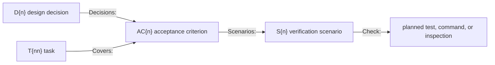
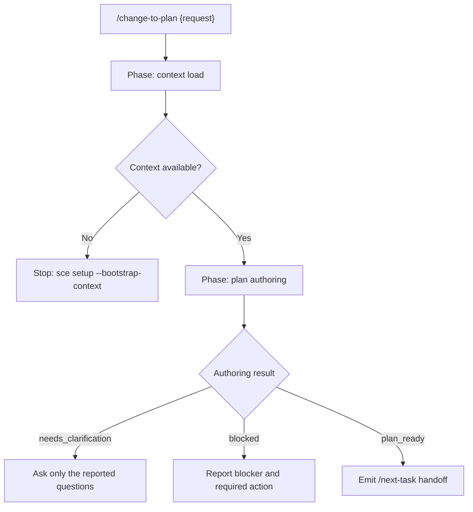

# Shared Context Plan Workflow (`/change-to-plan`)

## Purpose

`/change-to-plan` turns one change request into one scoped implementation plan under `context/plans/`. The generated OpenCode Plan agent is only a routing surface. Every target renders the same behavior into the single `sce-change-to-plan` workflow skill. `SKILL.md` owns ordering, branching, and same-session waits; package-local `context-load.md` and `plan-authoring.md` references own the two phases below, and `plan-template.md` owns the persisted plan format. They are not separate generated skill packages.

## Command entrypoint

`/change-to-plan {change request}`

The request must be non-empty. The workflow does not accept approval or execution flags.

## Phase ownership

Phase names below identify canonical modules in `config/pkl/base/workflow-change-to-plan.pkl` and the internal phases they compose into.

1. `sce-context-load`
   - Confirms whether `context/` exists.
   - Loads only durable context relevant to the requested focus.
   - Reports gaps and context-versus-code drift without editing context.
   - Returns `loaded` or `bootstrap_required`.
2. `sce-plan-authoring`
   - Runs only from a complete `loaded` handoff.
   - Resolves ambiguity and material decisions before writing.
   - Creates or updates one plan with stable task IDs, explicit scope, dependencies, done checks, and verification notes.
   - Returns `plan_ready`, `needs_clarification`, or `blocked`.

Every target keeps those statuses and their data as internal state inside `sce-change-to-plan` and continues immediately across the phase boundary. No sibling skill handoff and no serialized phase-result contract exists on any target.

## Bootstrap boundary

When context loading returns `bootstrap_required`, the workflow stops without creating context and tells the user to run:

`sce setup --bootstrap-context`

After the user reports that bootstrap completed, the waiting workflow re-runs the
context-load phase and continues with the original request in the same session.

## Planning boundary

- Planning does not implement application or test changes.
- One invocation authors at most one plan.
- Every executable task is sliced as one coherent commit unit by default.
- Durable repository context is read, not synchronized, during planning.
- A ready plan ends with an exact `/next-task {plan-path} {task-id}` handoff; the workflow does not request implementation approval itself.

## Plan format

`references/plan-template.md`, rendered from `changeToPlanPlanTemplate`, is the
only owner of the persisted plan schema and its rules. Alongside the compact
task, completion, and synchronization-lifecycle fields, it defines an optional
structured layer:

- `## Design decisions` with `D1..Dn` entries, each carrying `Boundary:`,
  `Rationale:`, `Rejected:`, and `Trade-offs:`.
- One-line reference fields: `Decisions:` and `Scenarios:` on each acceptance
  criterion, and `Covers:` on each task.
- `### Verification scenarios` with `S1..Sn` entries, each carrying `Given:`,
  `When:`, `Then:`, and `Check:`.

The template's `Reference rules` make the relationships extractable by line
matching. Each ID is defined once. Decision, criterion, and scenario IDs are
never renumbered or reused. Every reference resolves. Every criterion has
`Scenarios:` (IDs or `none (inspection)`), is covered by a task, and every
scenario is referenced by a criterion. A planned `Check:` is not evidence.

Plan structure is read only outside fenced code blocks, so a fenced example that
repeats real IDs or headings defines nothing and stays in place. A definition
counts only in its own section (`D` under `## Design decisions`, `AC` under
`## Acceptance criteria`, `S` under `### Verification scenarios`, `T` under
`## Task stack`, each ending at the next heading), and its fields are the lines
indented under it. To check a fenced example itself, its content is extracted
and checked as a separate sample document. `/change-to-plan`, `/next-task`, and
`/validate` all read plans this way.

A plan is **structured** when, outside fenced code blocks, it has a
`### Verification scenarios` heading or any task under `## Task stack` carries
`Covers:`; every other plan is **legacy** and keeps the prior format. A revision keeps a legacy plan legacy unless the correction explicitly
asks to adopt the structured format.

The plan-authoring phase writes this layer in a fixed order: design decisions,
then acceptance criteria with their `Decisions:` and `Scenarios:`, then
verification scenarios, then tasks with `Covers:`. It records only real
architectural choices and omits `## Design decisions` when there are none. It
writes scenarios only for the case kinds (normal, boundary, failure,
cancellation, concurrency, recovery) the change makes relevant, and a `Check:`
never names a test that neither exists nor is created by a task. Before writing
a structured plan, a reference-consistency pass applies every `Reference rules`
entry to the full draft and fixes each defect first. After writing a structured
plan, it runs `sce plan check {plan-path}`, fixes every reported diagnostic, and
re-runs the checker before returning `plan_ready`. A legacy-plan revision
skips this structured work, including the checker. The phase cites the template's rule sections by
name and does not restate them.

Responsibility for structural consistency is split by surface. Generation checks
(`nix run .#pkl-check-generated`, also run by `nix flake check`) verify the plan
template and the behavior of the structural checker
`config/pkl/renderers/plan-structure-check.pkl` against fixtures only; they never
read `context/plans/`, so an incomplete or malformed working plan cannot fail Nix
CI. Plan authoring produces structurally consistent plans. Plan validation checks
the selected plan's references and its actual verification evidence. For one
selected plan, the shipped `sce plan check <path>` command (see
[plan service](../cli/plan-service.md)) is the deterministic checker; the Pkl
checker stays the generation-time reference implementation and is still
runnable with
`pkl eval -p planPath=<plan> config/pkl/renderers/plan-structure-check.pkl`.

`/change-to-plan` (after writing) and `/validate` (step 4, before scenario
verification) run `sce plan check {plan-path}` on structured plans only;
`/validate` records each diagnostic as a failed check. Both trust a result only
when the checker actually ran: exit `0` with
`structured plan: reference integrity holds` or
`legacy plan: structured reference rules do not apply` on stdout, or exit `3`
with diagnostics. Any other outcome, such as an older `sce` that answers the
unknown `plan` command with help and exit `0`, means the checker is unavailable,
and the workflow applies the manual `Reference rules` pass instead and records
the fallback. `/next-task` never invokes the checker.

## Continuation contract

Same-session waits preserve one of two explicit continuation shapes inside the
single `sce-change-to-plan` skill:

- Initial clarification keeps `original_request`, `clarification_answers`, and
  `loaded_context_brief`. The original request is unchanged and is never
  re-requested after the clarification wait.
- Existing-plan revision keeps `plan_path`, `correction`, and
  `loaded_context_brief`.

The plan-authoring phase receives the applicable continuation fields as written;
it does not reload durable context or require a sibling skill handoff.

## Flow

## Target ownership

- OpenCode, Claude, and Pi: one thin command (Pi: prompt) invoking `sce-change-to-plan`; package files are `SKILL.md`, `references/context-load.md`, `references/plan-authoring.md`, `references/plan-template.md`, and `references/output.md`.
- `SKILL.md` reads the applicable phase reference before running that phase; a bootstrap stop never loads plan authoring.
- OpenCode adds `entry-skill` and a one-entry `skills` list naming that skill, and its Plan routing agent allows exactly `sce-change-to-plan`.

## Canonical sources

- `config/pkl/base/workflow-change-to-plan.pkl`
- Workflow composition: `config/pkl/renderers/workflow-composite.pkl` (shared by all three targets)
- Behavioral baseline: `.pi/prompts/change-to-plan.md`
