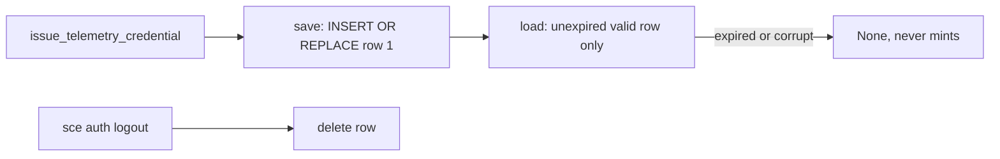

# Telemetry credential

The CLI holds one telemetry-only OpenBao credential, issued by the Control Plane and cached in the encrypted auth DB. `sce auth login` provisions it best-effort, and managed OTLP trace and log export reads it at startup as the bearer source. There is no user-facing provisioning command, refresh loop, or doctor check.

## Components

- Client: `AuthenticatedControlPlaneClient::issue_telemetry_credential` in `cli/src/services/agent_trace_sync/control_plane.rs` posts to `/auth/telemetry/credential` with the WorkOS bearer and no body, and validates `{ token, accessor, expiresAt }` (non-empty token and accessor, future RFC3339 `expiresAt`).
- Save-on-issue: `issue_and_save_telemetry_credential` persists only after successful issuance, so any failure leaves previously stored state intact.
- Storage: `cli/src/services/telemetry_credential_storage.rs` (`save_telemetry_credential`, `load_telemetry_credential`, `delete_telemetry_credential`) over the shared `AuthDb`; schema in [auth-db.md](auth-db.md).
- Auth login provisioning: every successful `sce auth login` path — fresh device authorization, valid stored credentials, and renewed stored credentials — invokes `AuthenticatedControlPlaneClient::issue_and_save_telemetry_credential` after WorkOS persistence. The deterministic `telemetry_provisioning` result reports `issued` or `unavailable`; unavailable provisioning preserves WorkOS authentication success and gives text callers a fixed secret-free retry warning.

## Lifecycle

- Lookup never mints or refreshes; an expired, empty-field, or negative-expiry row is returned as `None`.
- Concurrent saves are single-statement atomic replacements of one fixed row; the last complete writer wins.
- `sce auth logout` deletes the WorkOS credential and the telemetry credential, attempting both even when one fails and surfacing the first storage error. `credentials_removed` is true when either record was deleted; output fields are otherwise unchanged.
- Telemetry save/delete never touches the WorkOS `auth_credentials` row.

## Runtime use

- `managed_telemetry::RuntimeTelemetry::resolve` reads the stored credential at CLI startup (never issuing one); a valid unexpired `token` is used only as the `Authorization: Bearer` credential for managed OTLP trace and log export; the `accessor` is never transmitted. Absent, expired, malformed, or unavailable rows select `NoopTelemetry`. See [cli-observability-contract.md](cli-observability-contract.md).

## Security boundaries

- Identity and workspace enforcement belong to the backend; the CLI does not read `user.id` / `workspace.id` from `/me` and does not bind or compare identity on lookup.
- Local deletion does not revoke the OpenBao token; server-side revocation is out of scope and the token remains valid until it expires.
- Token and accessor never appear in errors, logs, or `Debug` output; `TelemetryCredential` and the issuance response redact them, client and storage errors use fixed messages, and auth login's best-effort provisioning warning contains no credential or raw server-response data.
- Encryption reuses the auth DB key handling described in [auth-db.md](auth-db.md).

See also: [auth-db.md](auth-db.md), [../context-map.md](../context-map.md)
