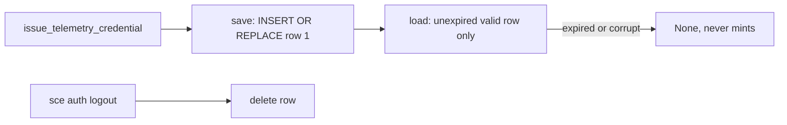

# Telemetry credential

The CLI holds one telemetry-only OpenBao credential, issued by the Control Plane and cached in the encrypted auth DB. `sce auth login` provisions it best-effort, and managed OTLP trace and log export reads it at startup as the bearer source. There is no user-facing provisioning command, refresh loop, or doctor check.

## Components

- Client: `AuthenticatedControlPlaneClient::issue_telemetry_credential` in `cli/src/services/agent_trace_sync/control_plane.rs` posts to `/auth/telemetry/credential` with the WorkOS bearer and no body, and validates `{ token, accessor, expiresAt }` (non-empty token and accessor, future RFC3339 `expiresAt`).
- Save-on-issue: `issue_and_save_telemetry_credential` persists only after successful issuance, so any failure leaves previously stored state intact.
- Storage: `cli/src/services/telemetry_credential_storage.rs` (`save_telemetry_credential`, `load_telemetry_credential`, `delete_telemetry_credential`) over the shared `AuthDb`; schema in [auth-db.md](auth-db.md).
- Auth login provisioning: every successful `sce auth login` path — fresh device authorization, valid stored credentials, and renewed stored credentials — invokes `AuthenticatedControlPlaneClient::issue_and_save_telemetry_credential` after WorkOS persistence. The deterministic `telemetry_provisioning` result reports `issued` or `unavailable`; unavailable provisioning preserves WorkOS authentication success and gives text callers a fixed secret-free retry warning.

## Lifecycle

- Lookup never mints or refreshes; an expired, empty-field, or negative-expiry row is returned as `None`.
- Ownership: a telemetry credential belongs to the stored WorkOS session it was issued under. A new device-authorization login deletes the stored telemetry credential before saving the new WorkOS session (`replace_session_with`), so a failed re-issuance leaves no credential from a previous identity; if that delete fails, the new session is not saved. Lookup returns `None` when no WorkOS session row exists. Renewal of the same session keeps the credential.
- Concurrent saves are single-statement atomic replacements of one fixed row; the last complete writer wins.
- `sce auth logout` deletes the WorkOS credential and the telemetry credential, attempting both even when one fails and surfacing the first storage error. `credentials_removed` is true when either record was deleted; output fields are otherwise unchanged.
- Telemetry save/delete never touches the WorkOS `auth_credentials` row.

## Runtime use

- `managed_telemetry::RuntimeTelemetry::resolve` reads the stored credential at CLI startup (never issuing one); a valid unexpired `token` is used only as the `Authorization: Bearer` credential for managed OTLP trace and log export; the `accessor` is never transmitted. Absent, expired, malformed, or unavailable rows select `NoopTelemetry`. See [cli-observability-contract.md](cli-observability-contract.md).

## Hidden header helper

- `sce auth telemetry-headers` is a hidden (`hide = true`) subcommand intended for Claude Code's `otelHeadersHelper`. It loads the stored credential on every call, bounded by `CREDENTIAL_LOOKUP_DEADLINE`, and prints exactly one JSON object, `{"Authorization":"Bearer <token>"}`, so a replaced credential is picked up on the next call.
- Endpoint check: the helper prints headers only when its inherited environment has `OTEL_EXPORTER_OTLP_ENDPOINT` equal to the managed endpoint and every per-signal endpoint variable that is set equal to the managed per-signal URL. This is enforced only against the environment Claude Code passes to the helper; it is not endpoint pinning inside Claude Code.
- Attribution: the helper prints headers only when the session directory (`CLAUDE_PROJECT_DIR`, else the working directory) is inside a Git repository whose `.claude/settings.json` contains the SCE Claude hook marker, that is, a repository where `sce setup --claude` installed the integration. Other repositories get no token, so their Claude telemetry is not attributed to the stored workspace.
- A missing, expired, malformed, ownerless, timed-out, or unavailable credential, an unexpected endpoint, or an unattributed repository exits nonzero with the fixed stderr diagnostic `Telemetry credential is unavailable.` and empty stdout. The helper performs no issuance or network call, needs no Git repository, and never initializes managed exporter telemetry.
- It is omitted from `sce --help`, `sce auth --help`, and shell completions, and is not a security boundary.

## Security boundaries

- Identity and workspace enforcement belong to the backend; locally the CLI binds the credential to the stored WorkOS session lifecycle (see Ownership) and does not read `user.id` / `workspace.id` from `/me`.
- Local deletion does not revoke the OpenBao token; server-side revocation is out of scope and the token remains valid until it expires.
- Token and accessor never appear in errors, logs, or `Debug` output; `TelemetryCredential` and the issuance response redact them, client and storage errors use fixed messages, and auth login's best-effort provisioning warning contains no credential or raw server-response data.
- Encryption reuses the auth DB key handling described in [auth-db.md](auth-db.md).

## Claude-native telemetry

Claude Code's own OpenTelemetry export is separate from the SCE-CLI managed exporter above. `sce setup` configures it; the SCE CLI exporter is unchanged.

- Install: when the Claude target is selected and setup proceeds (`--claude`, `--all`, interactive Claude/All, with or without `--non-interactive`), `cli/src/services/setup/claude_telemetry.rs` merges settings into Claude's user-level `settings.json` (`$CLAUDE_CONFIG_DIR/settings.json`, else `~/.claude/settings.json`). OpenCode/Codex/Pi-only, `--hooks`-only, `--bootstrap-context`, and cancelled runs leave it untouched. Scope is user-level, not repository-level.
- Written keys: `otelHeadersHelper` set to `sce auth telemetry-headers`, plus an `env` block with `CLAUDE_CODE_ENABLE_TELEMETRY=1`, `CLAUDE_CODE_ENHANCED_TELEMETRY_BETA=1` (required by Claude Code for span tracing), `OTEL_{TRACES,METRICS,LOGS}_EXPORTER=otlp`, `OTEL_EXPORTER_OTLP_PROTOCOL` / `OTEL_EXPORTER_OTLP_ENDPOINT` from `MANAGED_OTLP_PROTOCOL` / `MANAGED_OTLP_ENDPOINT`, `CLAUDE_CODE_OTEL_HEADERS_HELPER_DEBOUNCE_MS=300000`, and `OTEL_METRICS_INCLUDE_REPOSITORY=true` (unconditional because the Claude Code version cannot be detected during setup; unknown variables are ignored).
- Authentication: no token is ever written to settings, generated assets, or setup output, and `OTEL_EXPORTER_OTLP_HEADERS` is never set. Claude runs the hidden helper (see Hidden header helper) and uses its `Authorization` header.
- Rotation: Claude re-runs the helper at most every five minutes (debounce 300000 ms), so a credential replaced by a later `sce auth login` is picked up without rewriting settings. `sce auth logout` deletes the stored credential, after which the helper fails and Claude export stops authenticating; local deletion does not revoke the OpenBao token.
- Setup before login: setup succeeds and reports `authentication pending` when no valid stored credential exists; export begins once `sce auth login` stores one.
- Failure handling: the helper's failure is nonzero with empty stdout and the fixed diagnostic `Telemetry credential is unavailable.`, and never affects other Claude behavior beyond missing telemetry auth.
- Merge safety: repeated setup is byte-idempotent; unrelated settings, env, permissions, and hooks are preserved; writes are atomic via temp-file rename; an existing file's mode is kept and a new file uses `0600`; malformed JSON is never overwritten.
- Conflicts and limits: a user-owned `otelHeadersHelper`, an explicit opt-out (`CLAUDE_CODE_ENABLE_TELEMETRY`, `CLAUDE_CODE_ENHANCED_TELEMETRY_BETA`, or `ENABLE_ENHANCED_TELEMETRY_BETA` not `1`, or any `OTEL_*_EXPORTER=none`), `OTEL_METRICS_INCLUDE_REPOSITORY` other than `true`, a different helper refresh interval, or a differing generic/per-signal OTLP endpoint, headers, protocol, or exporter in user settings or in the Linux/macOS managed-settings file (`/etc/claude-code/managed-settings.json`, `/Library/Application Support/ClaudeCode/managed-settings.json`), causes the telemetry install to be skipped and reported with the specific reason while repository setup still succeeds. Setup looks up the stored credential, bounded by `CREDENTIAL_LOOKUP_DEADLINE`, only after a successful install. Environment variables present in a future Claude launch cannot be detected by setup and can override user settings.

See also: [auth-db.md](auth-db.md), [cli-observability-contract.md](cli-observability-contract.md), [../context-map.md](../context-map.md)
