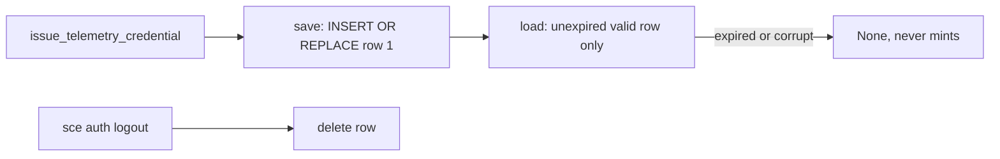

# Telemetry credential

The CLI holds one telemetry-only OpenBao credential, issued by the Control Plane and cached in the encrypted auth DB. `sce auth login` provisions it best-effort, and managed OTLP trace and log export reads it at startup as the bearer source. There is no user-facing provisioning command, refresh loop, or doctor check.

## Components

- Client: `AuthenticatedControlPlaneClient::issue_telemetry_credential` in `cli/src/services/agent_trace_sync/control_plane.rs` posts to `/auth/telemetry/credential` with the WorkOS bearer and no body, and validates `{ token, accessor, expiresAt }` (non-empty token and accessor, future RFC3339 `expiresAt`).
- Identity: the credential is bound to the `(sub, workspace_id)` claims of the exact WorkOS access token sent with the issuance request, the same verified claims Control Plane reads into `CurrentUser` to mint the token. If that bearer has no complete identity (no `workspace_id`, or an undecodable token), issuance fails with the fixed invalid-response error and nothing is saved.
- Save-on-issue: `issue_and_save_telemetry_credential` persists only after successful issuance, so any failure leaves previously stored state intact.
- Storage: `cli/src/services/telemetry_credential_storage.rs` (`save_telemetry_credential`, `load_telemetry_credential`, `delete_telemetry_credential`) over the shared `AuthDb`; schema in [auth-db.md](auth-db.md).
- Auth login provisioning: every successful `sce auth login` path — fresh device authorization, valid stored credentials, and renewed stored credentials — invokes `AuthenticatedControlPlaneClient::issue_and_save_telemetry_credential` after WorkOS persistence. The deterministic `telemetry_provisioning` result reports `issued` or `unavailable`; unavailable provisioning preserves WorkOS authentication success and gives text callers a fixed secret-free retry warning.

## Lifecycle

- Lookup never mints or refreshes; an expired, empty-field, negative-expiry, or identity-less (pre-`004` legacy) row is returned as `None`, so legacy rows require one `sce auth login`.
- Ownership: every lookup decodes the stored WorkOS session's access-token claims and returns the credential only when `(sub, workspace_id)` equals the identity stored with it. Switching user or workspace therefore makes an older credential unusable even if it was never deleted. A new device-authorization login also deletes the stored telemetry credential before saving the new WorkOS session (`replace_session_with`), so a failed re-issuance leaves no credential; if that delete fails, the new session is not saved. Renewal of the same session keeps the credential.
- Repository bindings: `telemetry_repository_bindings` maps a repository ID (the canonical `repository_identity` hash, from `agent_trace.repository_id` or the configured remote) to the `(user_id, workspace_id)` it was enrolled under. Enrollment requires a valid, session-owned credential and records that credential's identity. `sce setup` with the Claude target enrolls the repository explicitly (`Enroll`, rebinding it to the current identity). A successful `sce auth login` enrolls the working-directory repository only if it is unbound (`EnrollIfUnbound`), so a login never silently moves a repository to another workspace. Bindings survive logout and rotation; they authorize nothing without a matching credential.
- Concurrent saves are single-statement atomic replacements of one fixed row; the last complete writer wins.
- `sce auth logout` deletes the WorkOS credential and the telemetry credential, attempting both even when one fails and surfacing the first storage error. `credentials_removed` is true when either record was deleted; output fields are otherwise unchanged.
- Telemetry save/delete never touches the WorkOS `auth_credentials` row.

## Runtime use

- `managed_telemetry::RuntimeTelemetry::resolve` reads the stored credential at CLI startup (never issuing one); a valid unexpired `token` is used only as the `Authorization: Bearer` credential for managed OTLP trace and log export; the `accessor` is never transmitted. Absent, expired, malformed, or unavailable rows select `NoopTelemetry`. Every Noop fallback after a lookup is classified (`credential_unavailable`, `credential_expired`, `lookup_timeout`, `database_error`, `path_resolution_error`, `exporter_init_failed`) and logged locally as `sce.telemetry.fallback`; failures log at `warn` (forced, so they reach the log file at the default `error` level, never stderr while `log_to_file=true`), with the redacted `TokenStorageError` text for database and path errors, and missing or expired credentials log at `debug`. Concurrent lookups from many hook processes are supported by the auth DB's multiprocess WAL and migration-free current-schema open ([auth-db.md](auth-db.md)). Claude-invoked SCE hooks are admitted to this lookup and export one `sce.hook` span. Every other hook and this hidden header helper skip the lookup and stay Noop. See [cli-observability-contract.md](cli-observability-contract.md).

## Hidden header helper

- `sce auth telemetry-headers` is a hidden (`hide = true`) subcommand intended for Claude Code's `otelHeadersHelper`. On every call it prints exactly one JSON object, `{"Authorization":"Bearer <token>"}`, so a replaced credential is picked up on the next call.
- Launch context (verified against Claude Code 2.1.284 with a real `claude -p` run): Claude runs the helper with no arguments, with its working directory set to the directory Claude was launched from (possibly a subdirectory), and without `CLAUDE_PROJECT_DIR`. Claude's documentation states that it does not pass `OTEL_*` variables to subprocesses. The helper therefore uses only the working directory, ignores `CLAUDE_PROJECT_DIR` (a value inherited from a parent session could name another project), and never requires an `OTEL_*` variable to be present.
- Authorization: the helper walks up to the enclosing Git root, resolves the repository ID with the same precedence as Agent Trace storage, and prints headers only when that repository is bound to the identity of a valid credential that the current WorkOS session owns (see Repository bindings). An unbound repository, a repository bound to another user or workspace, a directory outside Git, or a repository without a resolvable identity gets no token. `.claude/settings.json`, SCE hook markers, and remote names are never treated as proof of ownership.
- Destination tripwire: if `OTEL_EXPORTER_OTLP_ENDPOINT`, a per-signal `OTEL_EXPORTER_OTLP_{TRACES,METRICS,LOGS}_ENDPOINT`, or `BETA_TRACING_ENDPOINT` is visible to the helper with a non-canonical value, the helper refuses. This catches visible misconfiguration only. It is not endpoint pinning (see Security boundaries).
- Repository resolution and the credential lookup together are bounded by `CREDENTIAL_LOOKUP_DEADLINE`. Resolution spawns one `git config --get` process, which is needed to compute the repository ID; there is no network call and no issuance. Every failure exits nonzero with the fixed stderr diagnostic `Telemetry credential is unavailable.` and empty stdout. The helper never initializes managed exporter telemetry.
- It is omitted from `sce --help`, `sce auth --help`, and shell completions.

## Security boundaries

- Enforced: a token is printed only for a repository enrolled under the identity that owns both the stored credential and the current WorkOS session. Telemetry from a repository enrolled under workspace B cannot be authorized with workspace A's credential, even when both repositories use SCE.
- Trust boundary: the local OS account. Any process running as the user can run `sce auth telemetry-headers` from an enrolled repository, or read the auth DB key, and obtain the token. The helper is not a defense against code the user executes; it prevents accidental cross-workspace attribution and refuses visible misdirection.
- Endpoint pinning is not claimed. The helper cannot observe Claude's effective exporter destination. Claude's documentation says `OTEL_*` variables are not passed to subprocesses, and in testing, project-level `env` overrides were not visible to the helper. Server-managed settings and `--settings` files are also not inspectable from the helper. Claude itself pins the destination only when the endpoint, or `otelHeadersHelper`, is set in managed settings (Claude Code 2.1.217+ for per-signal endpoints, 2.1.251+ for `BETA_TRACING_ENDPOINT`); a user-level install has no such guarantee.
- Residual risk: with a user-level install, any configuration path that Claude honors but the helper cannot see (a shell `OTEL_*`/`BETA_TRACING_ENDPOINT` variable in a Claude version that strips them from helpers, `--settings`, or a future precedence change) can send the bearer to another collector. The exposure is bounded by the token's scope: telemetry-only, non-renewable, 90-day lifetime. Local deletion does not revoke it; server-side revocation by accessor is not yet available. Organizations that need an enforced destination should set `OTEL_EXPORTER_OTLP_ENDPOINT=https://otel.crocoderlab.dev` and `otelHeadersHelper` in Claude managed settings.
- Token and accessor never appear in errors, logs, or `Debug` output; `TelemetryCredential` and the issuance response redact them, client and storage errors use fixed messages, and auth login's best-effort provisioning warning contains no credential or raw server-response data. The bearer is never written to Claude settings.
- Encryption reuses the auth DB key handling described in [auth-db.md](auth-db.md).

## Claude-native telemetry

Claude Code's own OpenTelemetry export is separate from the SCE-CLI managed exporter above. `sce setup` configures it; the SCE CLI exporter is unchanged.

- Install: when the Claude target is selected and setup proceeds (`--claude`, `--all`, interactive Claude/All, with or without `--non-interactive`), `cli/src/services/setup/claude_telemetry.rs` merges settings into Claude's user-level `settings.json` (`$CLAUDE_CONFIG_DIR/settings.json`, else `~/.claude/settings.json`). OpenCode/Codex/Pi-only, `--hooks`-only, `--bootstrap-context`, and cancelled runs leave it untouched. Scope is user-level, not repository-level.
- Written keys: `otelHeadersHelper` set to `sce auth telemetry-headers`, plus an `env` block with `CLAUDE_CODE_ENABLE_TELEMETRY=1`, `CLAUDE_CODE_ENHANCED_TELEMETRY_BETA=1` (required by Claude Code for span tracing), `OTEL_{TRACES,METRICS,LOGS}_EXPORTER=otlp`, `OTEL_EXPORTER_OTLP_PROTOCOL` / `OTEL_EXPORTER_OTLP_ENDPOINT` from `MANAGED_OTLP_PROTOCOL` / `MANAGED_OTLP_ENDPOINT`, `CLAUDE_CODE_OTEL_HEADERS_HELPER_DEBOUNCE_MS=300000`, and `OTEL_METRICS_INCLUDE_REPOSITORY=true` (unconditional because the Claude Code version cannot be detected during setup; unknown variables are ignored).
- Authentication: no token is ever written to settings, generated assets, or setup output, and `OTEL_EXPORTER_OTLP_HEADERS` is never set. Claude runs the hidden helper (see Hidden header helper) and uses its `Authorization` header.
- Rotation: Claude re-runs the helper at most every five minutes (debounce 300000 ms), so a credential replaced by a later `sce auth login` is picked up without rewriting settings. `sce auth logout` deletes the stored credential, after which the helper fails and Claude export stops authenticating; local deletion does not revoke the OpenBao token.
- Repository enrollment: after a successful install, setup enrolls the current repository under the stored credential's identity, bounded by `CREDENTIAL_LOOKUP_DEADLINE`. When no valid session-owned credential exists, setup succeeds and reports `authentication pending for this repository`; running `sce auth login` inside the repository enrolls it and starts export.
- Failure handling: the helper's failure is nonzero with empty stdout and the fixed diagnostic `Telemetry credential is unavailable.`, and never affects other Claude behavior beyond missing telemetry auth.
- Merge safety: repeated setup is byte-idempotent; unrelated settings, env, permissions, and hooks are preserved; writes are atomic via temp-file rename; an existing file's mode is kept and a new file uses `0600`; malformed JSON is never overwritten.
- Conflicts and limits: a user-owned `otelHeadersHelper`, an explicit opt-out (`CLAUDE_CODE_ENABLE_TELEMETRY`, `CLAUDE_CODE_ENHANCED_TELEMETRY_BETA`, or `ENABLE_ENHANCED_TELEMETRY_BETA` not `1`, or any `OTEL_*_EXPORTER=none`), `OTEL_METRICS_INCLUDE_REPOSITORY` other than `true`, a different helper refresh interval, or a differing generic/per-signal OTLP endpoint, headers, protocol, or exporter in user settings or in the Linux/macOS managed-settings file (`/etc/claude-code/managed-settings.json`, `/Library/Application Support/ClaudeCode/managed-settings.json`), causes the telemetry install to be skipped and reported with the specific reason while repository setup still succeeds. Setup enrolls the repository only after a successful install. Environment variables present in a future Claude launch cannot be detected by setup and can override user settings.

See also: [auth-db.md](auth-db.md), [cli-observability-contract.md](cli-observability-contract.md), [../context-map.md](../context-map.md)
